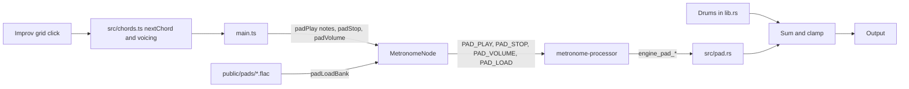

# Chord Pads Design

**Spec**: `.specs/features/chord-pads/spec.md`
**Status**: Approved

---

## Architecture Overview

The pad is a new module, `src/pad.rs`, owned by the Rust `Engine` and mixed into `fill_buffers` after the drums. The page only says which notes to hold; every fade, voice and effect runs on the audio thread, where `cargo test` reaches it. Which chord exists, how it is voiced and spelled, and what a click means are pure TypeScript in `src/chords.ts`, reached by Vitest.



**Approaches considered**

| Approach | Verdict |
| -------- | ------- |
| Pad inside the Rust engine | Chosen: the user asked for it in "nosso motor", it shares the output and its clamp, and `cargo test` reaches every rule |
| Web Audio nodes in TypeScript (`AudioBufferSourceNode`, `ConvolverNode`) | Rejected: outside the engine, and Vitest with happy-dom renders no audio, so no criterion on sound could be proved |
| A second worklet with its own WASM instance | Rejected: same audio thread, so nothing is isolated, and two outputs bypass the shared clamp |

**Measured before designing**

- Worst case in WASM under Node on this machine (Ryzen 5 3500X): 3 chords × 5 notes × 7 saws, 15 interpolated samples, chorus and reverb take 0.032 ms on average per 128-frame block, of a 2.90 ms budget. The prototype's largest block took 0.68 ms.
- All 8 New Age files in range close their loop with a step of 0: `x[loop_end] == x[loop_start]`, so `loop_end` is inclusive and a plain wrap is seamless.
- Those 8 files take 2.6 MB. MIDI 45 to 70 needs `G#2 C3 E3 G#3 C4 E4 G#4 C5`.

---

## Code Reuse Analysis

### Existing Components to Leverage

| Component | Location | How to Use |
| --------- | -------- | ---------- |
| `loadIntoEngine` | `src/audio/metronome-processor.ts:178` | Copies a sample into the heap for `PAD_LOAD` |
| `decode` | `src/audio/MetronomeNode.ts:141` | Fetch and decode; mono falls back to the left channel |
| `loadKit`'s `Promise.allSettled` | `src/main.ts:174` | Isolates a failed file the same way, with its log |
| `views` and `setViewMode` | `src/main.ts:20`, `src/state.ts:206` | Add `improv` as a fourth view |
| `metrorig_view_mode` | `src/state.ts:199` | Remembers the screen; `metrorig_click_sound` is the pattern for the volume |
| `.view-link` | `index.html:20` | The `Improv` link |
| `tests/fixtures/build_house_kit_check.py` | `tests/fixtures/` | The pattern for a dev-tool fixture |

### Integration Points

| System | Integration Method |
| ------ | ------------------ |
| Rust engine | `Engine.pad: Pad`, mixed in `fill_buffers` |
| WASM binary | `public/pkg/metrorig_audio_bg.wasm` is tracked, so it is rebuilt with `npm run build:wasm` |
| Audio start | `initAudio` splits into `startEngine` and `loadKit` |

---

## Components

### Chord rules

- **Purpose**: Define the 168 chords, their voicing, their spelling and what a click does.
- **Location**: `src/chords.ts`
- **Interfaces**:
  - `ROOTS: string[]`, `CHORD_TYPES: { suffix: string; semitones: number[]; degrees: number[] }[]`
  - `chordName(root: number, type: number): string` - such as `C7M(9)`
  - `chordMidi(root: number, type: number): number[]` - PAD-02 and PAD-03
  - `chordNotes(root: number, type: number): string[]` - PAD-34
  - `nextChord(current: ChordId | null, clicked: ChordId): ChordId | null` - the same chord stops, another replaces
  - `parseVolume(stored: string | null): number` - PAD-44
- **Dependencies**: none
- **Reuses**: the pure-module shape of `src/kit.ts`

Spelling: the note of degree `d` takes the letter `d - 1` steps from the root's letter, plus the accidental that reaches its pitch. A double accidental is replaced by the natural note of that pitch.

### Pad bank data

- **Purpose**: List the shipped files and their loop points.
- **Location**: `src/chords.ts`, `PAD_BANK: { key: number; url: string; loopStart: number; loopEnd: number }[]`
- **Dependencies**: none
- **Reuses**: nothing

The 8 files sit in `public/pads/new-age/`, unchanged from FreePats except for `G#` becoming `Gs` in their names, because `#` breaks URLs.

### Pad engine

- **Purpose**: Hold, fade and render the pad.
- **Location**: `src/pad.rs`
- **Interfaces**:
  - `Pad::new(sample_rate: f32) -> Pad`
  - `play(&mut self, notes: &[u8])`, `stop(&mut self)`, `set_volume(&mut self, volume: f32)`
  - `load(&mut self, key: u8, left: &[f32], right: &[f32], loop_start: usize, loop_end: usize)`
  - `mix_into(&mut self, left: &mut [f32], right: &mut [f32])` - adds to the buffers, and returns at once while `is_silent()`
- **Dependencies**: none
- **Reuses**: `Sample` is not reused, because a pad sample keeps its onset; `trim_onset` would shift the loop points

Rules:
- Fixed arrays only: 3 `Slot`s of at most 5 `Voice`s, chorus and reverb buffers built in `new`.
- `play` first looks for a slot already holding these notes and turns it back up (PAD-39). Otherwise it sends every slot to 0 and starts a free one. With no free slot it fades the oldest over 20 ms and holds the notes in `pending`; a newer click replaces `pending`.
- A slot's linear `level` moves toward its target at `1 / (1.5 × sample_rate)` per frame, so a fade continues from any level (PAD-11). The gain is `sin(level × π / 2)`, equal power, because two chords are uncorrelated.
- `pending` and a slot's notes are copied into fixed arrays, so nothing allocates (PAD-59).
- A chord's gain is `1 / sqrt(notes)`, which PAD-14 proves.
- Each voice holds 7 sawtooth phases with PAD-18's detune, panned across the stereo field, and a sample position advancing by `2^((note - key) / 12)`, with linear interpolation. A note reads the loaded file nearest its `key`.
- `load` while a chord sounds raises a per-slot sample layer gain from 0 over 1.5 s (PAD-49).
- The volume reaches the mix through a 20 ms smoother (PAD-42).
- All delays scale with `sample_rate`. `decodeAudioData` converts files to the context's rate, so the pitch ratio stays pure and the page scales loop points by `sampleRate / 44100` (PAD-58).
- `is_silent()` turns true once every slot is off and the reverb tail stays under -90 dBFS for a block; `mix_into` then clears the buffers once and returns early, which gives PAD-29.

### Engine mix

- **Purpose**: Sum the pad with the drums, playing or stopped.
- **Location**: `src/lib.rs`
- **Interfaces**: `engine_pad_play(ptr, n0, n1, n2, n3, n4, count)`, `engine_pad_stop(ptr)`, `engine_pad_set_volume(ptr, volume)`, `engine_pad_load(ptr, key, loop_start, loop_end, left, right, length)`
- **Dependencies**: Pad engine
- **Reuses**: the C FFI pattern of `engine_load_take`

`fill_buffers` keeps its loop and calls `self.pad.mix_into`, then clamps, on both the playing and stopped paths. The stopped path clears the tick as today.

### Audio bridge

- **Purpose**: Carry the pad's commands and samples to the engine.
- **Location**: `src/audio/metronome-processor.ts`, `src/audio/MetronomeNode.ts`
- **Interfaces**: `padPlay(notes: number[])`, `padStop()`, `padVolume(volume: number)`, `padLoad(key, url, loopStart, loopEnd): Promise<void>`
- **Dependencies**: Engine mix
- **Reuses**: `decode`, `loadIntoEngine`

Files are sent one at a time, each awaiting the last, so no audio block carries more than one copy.

### Improv screen

- **Purpose**: Show the grid, the sounding chord, Stop, volume and notices, and light the header dot.
- **Location**: `index.html`, `src/main.ts`, `src/index.css`, `src/state.ts`
- **Interfaces**: `renderImprov()`, `ViewMode` gains `'improv'`, `localStorage` key `metrorig_pad_volume`
- **Dependencies**: Chord rules, Audio bridge
- **Reuses**: `.card`, `--neon-green`, `--mono` and the `.status-dot` of `.stitch/DESIGN.md`

Column layout: `position: sticky` on the root column inside an `overflow-x: auto` wrapper (PAD-41).

### Audio start

- **Purpose**: Let the pad run without the kit.
- **Location**: `src/main.ts`
- **Interfaces**: `startEngine(): Promise<void>` runs once; `initAudio` awaits it, then `loadKit` as today
- **Dependencies**: `MetronomeNode.init`
- **Reuses**: `initAudio`

Opening `Improv` calls `startEngine` and loads the bank, which makes no sound. A chord click calls `resumeContext` inside the gesture (PAD-56).

---

## Data Models

```typescript
interface ChordId { root: number; type: number } // Indexes into ROOTS and CHORD_TYPES
```

```rust
struct Voice { note: u8, position: f32, phases: [f32; 7] }
struct Slot { voices: [Voice; 5], count: usize, level: f32, target: f32, sample_gain: f32 }
struct PadSample { key: u8, left: Vec<f32>, right: Vec<f32>, loop_start: usize, loop_end: usize }
```

---

## Error Handling Strategy

| Error Scenario | Handling | User Impact |
| -------------- | -------- | ----------- |
| A pad file fails | `Promise.allSettled` logs its path; notes use the nearest loaded file | `Some samples unavailable` |
| Every pad file fails | The engine has no samples, and voices render the synth alone | `Samples unavailable · synth only` |
| `Improv` opens after a failure | Only files marked failed are fetched again | The notice clears on success |
| The engine fails to start | `startEngine` rejects and clears its promise, so a later click retries | `Audio unavailable`, no chord marked |
| A stored volume is invalid | `parseVolume` returns 70 | The default level |

---

## Risks & Concerns

| Concern | Location (file:line) | Impact | Mitigation |
| ------- | -------------------- | ------ | ---------- |
| `engine_alloc` and the sample copy run on the audio thread, while drums may be playing | `src/audio/metronome-processor.ts:178` | A long copy could glitch a block | Files go one at a time and are at most 400,000 frames; the walk loads them during a groove |
| The WASM memory grows while loading | `src/audio/metronome-processor.ts:241` | Stale heap views | `process` already rebuilds them; a test covers it with the pad |
| The output only clamps, and Kick peaks near full scale | `src/lib.rs:581` | Pad plus a hard hit can clip | PAD-27 caps the pad at -12 dBFS; PAD-37 checks it with a full groove |
| `fill_buffers` returns early while stopped | `src/lib.rs:492` | The pad would be silent | The stopped path calls `mix_into` |
| `initAudio` waits for the whole kit | `src/main.ts:193` | The first chord would wait | `startEngine` splits it |
| `src/lib.rs` is 2,689 lines | `src/lib.rs` | Harder to navigate | The pad lives in its own module with its own tests |
| `process` assumes the block is 128 frames | `src/audio/metronome-processor.ts:233` | None today | `mix_into` takes slices of any length |
| The speed was measured on a desktop, not on a phone | prototype | A slow phone could underrun | At 1% of the budget there is a margin of about 100 times; the walk watches for dropouts |
| Naive sawtooth aliasing | `src/pad.rs` | High notes could sound harsh | The top note is 466 Hz and the low-pass sits near 1 kHz; PAD-37 judges it |

---

## Tech Decisions

| Decision | Choice | Rationale |
| -------- | ------ | --------- |
| Interpolation | Linear | Ratios stay within ±2 semitones and the material is dark; PAD-37 would reveal dullness |
| Sample format | FLAC, as FreePats ships it | Lossless, 2.6 MB, decoded by `decodeAudioData` |
| Loop wrap | Inclusive `loop_end`, wrapping to `loop_start` | Measured step of 0 on all 8 files |
| Fade curve | Equal power over a linear level | Keeps loudness through a crossfade of unrelated chords |
| Reverb | Comb and all-pass network, as in demo 3 | Small, with no file, and the sound the user liked |
| Pad state on the page | The sounding chord lives in `main.ts`; the volume in `localStorage` | Q13 keeps chords out of saved state |
| Layer gains | Constants at the top of `src/pad.rs` | Ear tuning under PAD-38 changes one number |
