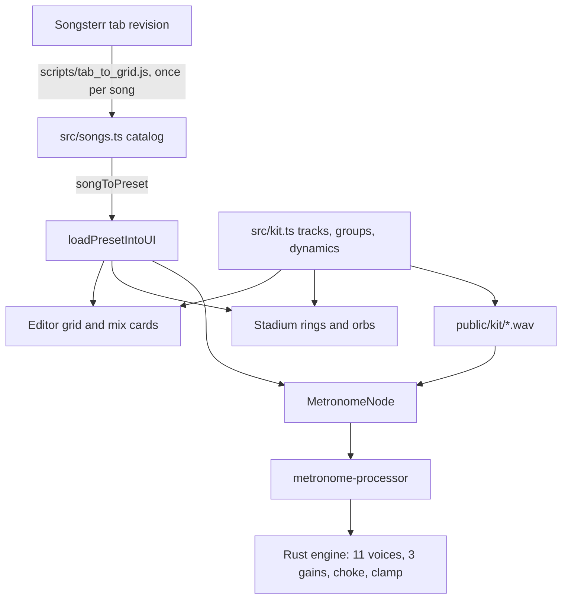

# Grooves Library Design

**Spec**: `.specs/features/grooves-library/spec.md`
**Status**: Approved

---

## Architecture Overview

The Rust engine stays the only sound source. It grows from 4 to 11 voices and reads a step's value as a dynamic. The page gains one module for the kit's rules and one for the song catalog; a song becomes an ordinary `Preset`, so it reuses every load, save, Mute and Solo path.



**Approaches considered.** Extending the Rust engine is the choice. Playing the new pieces through Web Audio nodes in JavaScript was rejected: it would split the timing into two clocks, and sample-accurate timing is what `precise-only` proved. Holding songs as a new type beside `Preset` was rejected too: it would duplicate load, save and playback paths.

---

## Code Reuse Analysis

### Existing Components to Leverage

| Component | Location | How to Use |
| --------- | -------- | ---------- |
| `loadPresetIntoUI` | `src/main.ts:707` | Loads a song, including the Trainer reset and the running-playback tempo jump |
| `normalizePreset` | `src/state.ts:53` | Fills missing tracks of stored presets and cleans step values |
| `audibleSteps`, `isAudible` | `src/trackMix.ts` | Already take any track id |
| `togglePlay` | `src/main.ts:429` | Runs `▶` and `■` on a card |
| `setViewMode` | `src/state.ts:172` | Widens from two modes to three |
| `.card`, `--track-color` | `src/index.css` | Style the Grooves cards and the new tracks |

### Integration Points

| System | Integration Method |
| ------ | ------------------ |
| Rust engine | `MAX_SAMPLES` becomes 11; `tracks`, `samples` and `playback_*` follow; `public/pkg` is rebuilt |
| AudioWorklet | `gridMirror` and the `activeTrackIds` loop cover 11 tracks |
| IndexedDB | No schema change: `gridData` is a map, so `metrorig_db` stays at version 2 |
| `localStorage` | `metrorig_view_mode` also accepts `grooves` |

---

## Components

### Kit rules

- **Purpose**: The one definition of tracks, Stadium groups and step dynamics.
- **Location**: `src/kit.ts`
- **Interfaces**:
  - `TRACKS: { id: number; name: string; label: string; sample: string | null }[]`
  - `STADIUM_GROUPS: { label: string; trackIds: number[] }[]`
  - `nextStepValue(trackId: number, value: number): number`
  - `groupHit(trackIds: number[], gridData: Record<number, number[]>, step: number): boolean`
- **Dependencies**: None
- **Reuses**: The pure-module pattern of `src/trackMix.ts`

### Song catalog

- **Purpose**: The 14 songs and their rules.
- **Location**: `src/songs.ts`
- **Interfaces**:
  - `SONGS: Song[]`
  - `songsForGenre(genre: GenreTab): Song[]`
  - `songToPreset(song: Song): Preset`
- **Dependencies**: `src/state.ts` types
- **Reuses**: `Preset`, `getBeatsPerMeasure`

### Tab converter

- **Purpose**: Turns one bar of a Songsterr drum part into a grid, so a transcription can be repeated and read.
- **Location**: `scripts/tab_to_grid.js`
- **Interfaces**:
  - `barToGrid(measure, timeSignature): { measureLength: number; tracks: Record<number, number[]> }`
  - Refuses a bar with a note that falls outside the step grid.
- **Dependencies**: None at run time. It is a development tool; the app never calls Songsterr.
- **Reuses**: `measureLengthFor` rule, restated for Node

### Grooves screen

- **Purpose**: Tabs and cards.
- **Location**: `index.html`, `src/main.ts`, `src/index.css`
- **Interfaces**: `drawGroovesScreen()`, and the card handlers `playSong(id)` and `openSongInEditor(id)`
- **Dependencies**: Song catalog, `togglePlay`, `loadPresetIntoUI`
- **Reuses**: `.card`, the `markPresetAsModified` path, which also records unsaved edits

### Rust voices

- **Purpose**: 11 sample voices, each reading its step value as a gain.
- **Location**: `src/lib.rs`
- **Interfaces**: `engine_load_sample` and `engine_update_grid` keep their signatures and accept ids up to 10.
- **Dependencies**: None
- **Reuses**: The existing sample playback loop

---

## Data Models

### Step values

| Value | Drum track | Click track |
| ----- | ---------- | ----------- |
| 0 | empty | empty |
| 1 | `normal`, gain 0.7 | `normal` |
| 2 | `accent`, gain 1.0 | `accent` |
| 3 | `ghost`, gain 0.3 | not used |

Values 1 and 2 keep their meaning, so a saved preset needs no migration. Normal is value 1, which makes every saved drum hit quieter than today: it plays at 0.7 of the piece's level. Each piece's level is set against this when the kit is balanced, so normal hits end up near today's loudness.

### Tracks

| Id | Name | Stadium group |
| -- | ---- | ------------- |
| 0 | `Click` | `CLICK` |
| 1 | `Kick` | `KICK` |
| 2 | `Snare` | `SNARE/TOMS` |
| 3 | `Hi-hat` | `CYMBALS` |
| 4 | `Open Hat` | `CYMBALS` |
| 5 | `Ride` | `CYMBALS` |
| 6 | `Ride Bell` | `CYMBALS` |
| 7 | `Crash` | `CYMBALS` |
| 8 | `China` | `CYMBALS` |
| 9 | `High Tom` | `SNARE/TOMS` |
| 10 | `Floor Tom` | `SNARE/TOMS` |

### Song

```typescript
type Genre = 'Rock' | 'Metal' | 'Metalcore' | 'Blues';
type GenreTab = Genre | 'All';

interface Song {
  id: string;            // song_back_in_black
  title: string;
  artist: string;
  genre: Genre;
  section: string;       // Verse
  bpm: number;           // what the Tempo Bus shows
  timeSignature: string;
  measureLength: number;
  gridData: Record<number, number[]>; // tracks 1 to 10; Click is derived
  source: { url: string; revisionId: number };
}
```

**Relationships**: `songToPreset` adds the `Click` track, a disabled Trainer and the song's id and title. A saved copy gets a `user_` id, so it never changes the catalog.

---

## Error Handling Strategy

| Error Scenario | Handling | User Impact |
| -------------- | -------- | ----------- |
| A drum sample fails to fetch or decode | `Promise.allSettled` over the loads; each failure goes to `console.error` | That piece stays silent, the rest play |
| Stored step value outside 0 to 3 | `normalizePreset` makes it 1 | The hit plays as `normal` |
| Bar does not fit the grid | `tab_to_grid.js` refuses it | The agent asks the user before picking another bar or dropping the song |
| User declines the confirmation | Handler returns before any change | Nothing changes |

---

## Risks & Concerns

| Concern | Location (file:line) | Impact | Mitigation |
| ------- | -------------------- | ------ | ---------- |
| The engine sums voices without a limit | `src/lib.rs:443` | 11 voices can pass 1.0 and clip in the browser | Clamp the output, and set piece levels so normal playing stays below it |
| `initAudio` awaits samples in sequence and one failure rejects it | `src/main.ts:157` | A failed sample stops all audio | `Promise.allSettled` in T7 |
| 11 fetches on the first Play | `src/main.ts:151` | The first hit waits for the downloads | Kit capped at 10 MB, one-shot tails trimmed |
| `samples: [None, None, None, None]` and `playback_volume` are fixed literals | `src/lib.rs:150` | They must grow by hand | T2 sizes them from `MAX_SAMPLES` |
| Hard-coded `trackId < 4` loops | `src/main.ts:189`, `src/main.ts:276`, `src/main.ts:361`, `src/main.ts:527`, `src/audio/metronome-processor.ts:213` | A new track would be silently ignored | Each loop reads `TRACKS.length`; catalog and integration tests use track 8 |
| `gridMirror` holds 4 rows | `src/audio/metronome-processor.ts:47` | `UPDATE_GRID` for a new track fails on read | T5 sizes it to 11 |
| `applyPattern` writes tracks 1 to 3 only | `src/main.ts:843` | A groove leaves stale cymbals behind | T11 covers tracks 1 to 10 |
| `FACTORY_PRESETS` and speed trainers store 4 tracks | `src/state.ts:269` | Loading them leaves new tracks undefined | `normalizePreset` runs on every load |
| Community tabs can be wrong | `src/songs.ts` | A groove differs from the record | The revision is stored, and the user approves by ear |
| Existing Rust tests assert unity gain on value 1 | `src/lib.rs:1633` | They fail by design with `normal` at 0.7 | They change in T2 to the spec's gain, and nothing else in them |

---

## Tech Decisions

| Decision | Choice | Rationale |
| -------- | ------ | --------- |
| Song data | Committed literals in `src/songs.ts` | Runs offline, and the app has no runtime tie to Songsterr |
| Output protection | Clamp at ±1.0 | Silent until an extreme hit, and leaves existing output values unchanged |
| Open Hat choke | Only `Hi-hat` cuts `Open Hat` | It is what a real hat does, and the spec names only that pair |
| Sample format | Mono or stereo 44.1 kHz WAV, trimmed with `ffmpeg` | The app already decodes WAV |
| Cymbal tails | Faded out within 2.5 s | Keeps the kit under 10 MB |
| Filter state | Session only | The spec opens on `All` the first time, and nothing asks to keep it |
