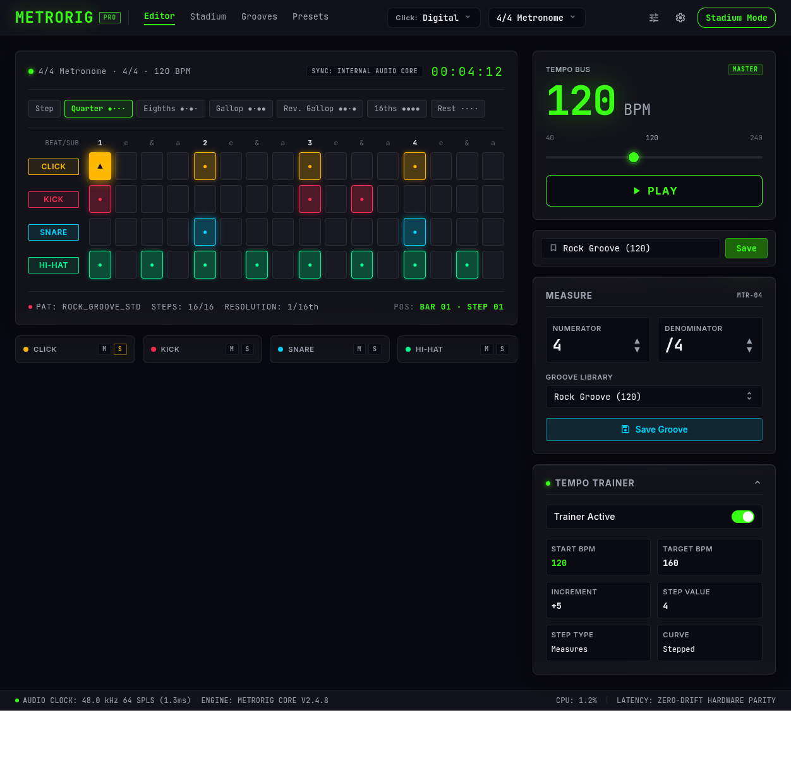
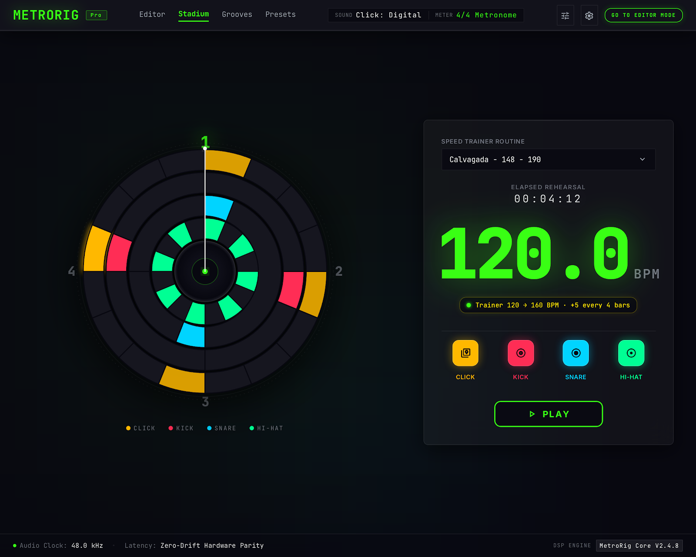

# Grooves Library Specification

**Approved**: 2026-11-01 - user: "aprovado"

## Problem Statement

MetroRig's header has no navigation, its only factory grooves are generic patterns, and its kit stops at kick, snare and hi-hat, all at one volume. A drummer cannot pick a famous song and practise its real part. This feature adds working `Editor`, `Stadium` and `Grooves` links, a screen of transcribed drum parts by genre, and the 11-track kit with dynamics those parts need.

## Goals

- [ ] The header links open all three screens at 1440, 1024 and 390px wide
- [ ] The 14 songs of `context.md` load and play at their source tempo
- [ ] Every song cites a Songsterr link and revision
- [ ] Every drum piece has a license that allows redistribution, recorded in the repository
- [ ] Every saved preset and groove keeps working, and every existing test not changed by this spec still passes

## Out of Scope

| Feature | Reason |
| ------- | ------ |
| `Presets` header link | Not requested; AD-007 |
| Whole-song arrangements and drum fills | Each entry holds 1 bar (Q6) |
| Audio from the recordings | Q3 |
| Velocity layers and round robin | The user chose 1 sample at 3 volumes (Q12) |
| More than 11 tracks | Q10 fixes the kit |
| Swing | Removed on purpose by `precise-only` |
| Search, favourites, user-added songs | Not requested |
| Link to the source on the card | Q8 and Q18 keep it in the data |
| More than 1 entry per song | No section was requested beyond the main bar |
| Mute/Solo per piece in the Stadium | Q15 |

---

## Assumptions & Open Questions

| Assumption / decision | Chosen default | Rationale | Confirmed? |
| --------------------- | --------------- | --------- | ---------- |
| Battery and Don't Need You | Added to the 2 songs proposed for their artists, making 14 | "pra metallica adicione batterry, pra bullet adicione dont need you" | y |
| Links at every width | Visible at 1440, 1024 and 390px | They are the only way to change screens; stated default | y |
| Last screen on reload | The last opened screen returns, Grooves included | Existing behaviour; stated default | y |
| Saved presets and grooves | Missing tracks read as empty | Stated default | y |
| Song in the preset selector | A `Songs` group holds all 14 songs | Stated default | y |
| Screen language | `All` and `Open in Editor`, not `Todos` and `Abrir no Editor` | Every other label in the app is English; Q20, user: "recomendacoes" | y |
| Track identifiers | Tracks 0 to 3 keep their ids; 4 to 10 are the new pieces | Saved presets must keep their meaning | y |
| Volumes | `ghost` 0.3, `normal` 0.7, `accent` 1.0 of the piece's level | Adjustable by ear before approval; Q21, user: "recomendacoes" | y |
| Confirmation dialog | The native `confirm`, as the app's other dialogs | `interface-v2` kept native dialogs | y |
| Kit license | SM Drums if its bundled terms allow redistribution; otherwise the Open Source Drumkit plus one CC0 China hit | SM Drums alone has every piece, and the sources disagree on its license; Q19, user: "recomendacoes" | y |
| No CC0 China found | The work stops and the user decides | No CC0 China hit is confirmed yet; a substitute is the user's call | y |

**Open questions:** none - all resolved or logged above.

---

## User Stories

### P1: Header navigation ⭐ MVP

**User Story**: As a drummer, I want links to each screen so that I can move between editing, practice and the song library.

**Why P1**: The Grooves screen cannot be reached without it.

**Acceptance Criteria**:

1. The header SHALL show the links `Editor`, `Stadium` and `Grooves` as drawn in `.specs/features/grooves-library/captures/editor.png`.
2. WHEN the user uses `Editor` THEN the system SHALL show only the Editor screen.
3. WHEN the user uses `Stadium` THEN the system SHALL show only the Stadium screen as drawn in `.specs/features/grooves-library/captures/stadium.png`.
4. WHEN the user uses `Grooves` THEN the system SHALL show only the Grooves screen.
5. The header SHALL mark the link of the open screen with `aria-current="page"` and no other link.
6. The header SHALL NOT show the `GO TO STADIUM MODE` toggle or a `Presets` link.
7. WHEN the page reloads THEN the system SHALL open the last screen the user opened.
8. WHILE playback runs, WHEN the user changes screens the system SHALL keep playing without a restart.
9. WHERE the window is 1440, 1024 or 390px wide the system SHALL show all three links with no horizontal page scroll.

**Independent Test**: Use each link at each width and reload.

---

### P1: Expanded kit ⭐ MVP

**User Story**: As a drummer, I want the pieces real parts use so that a song sounds like a drum kit.

**Why P1**: The transcriptions need these pieces.

**Acceptance Criteria**:

1. The system SHALL hold 11 tracks in this order: `Click`, `Kick`, `Snare`, `Hi-hat`, `Open Hat`, `Ride`, `Ride Bell`, `Crash`, `China`, `High Tom`, `Floor Tom`.
2. WHEN a step of a drum track is active THEN the engine SHALL play that track's sample on that step.
3. `Kick`, `Snare` and `Hi-hat` SHALL keep the samples of `scripts/generate_samples.js`, and the other 7 drum samples SHALL come from the Open Source Drumkit with one CC0 China hit, with each origin recorded in the repository.
4. WHEN a `Hi-hat` step plays while `Open Hat` rings THEN the engine SHALL stop `Open Hat`.
5. IF every track sounds on one step THEN the engine SHALL keep each output sample within -1.0 to 1.0.
6. IF a drum sample fails to load THEN the system SHALL log the failure, keep that track silent and keep the other tracks playing.
7. WHILE no drum sample is loaded the system SHALL keep the `Click` track audible.

**Independent Test**: Stamp one hit on every track, solo each track, and hear each piece.

---

### P1: Dynamics ⭐ MVP

**User Story**: As a drummer, I want accents and ghost notes so that a groove keeps its feel.

**Why P1**: Blues parts depend on them.

**Acceptance Criteria**:

1. WHEN a drum step is `ghost`, `normal` or `accent` THEN the engine SHALL play the sample at 0.3, 0.7 or 1.0 of the piece's level.
2. WHILE no figure is selected, WHEN the user clicks a drum cell the system SHALL move it through `empty`, `normal`, `accent`, `ghost` and back to `empty`.
3. WHILE no figure is selected, WHEN the user clicks a `Click` cell the system SHALL move it through `empty`, `normal`, `accent` and back to `empty`.
4. The grid SHALL show `●` for `normal`, `▲` for `accent` and a smaller dot for `ghost`.
5. WHEN the user stamps a figure THEN the system SHALL write its hits as `normal`.
6. WHEN the user saves and reloads a preset THEN the system SHALL keep each step's dynamic.

**Independent Test**: Cycle one snare cell through its states while playing and hear each volume.

---

### P1: Grooves screen ⭐ MVP

**User Story**: As a drummer, I want to browse songs by genre so that I can start one in a click.

**Why P1**: It is the point of the feature.

**Acceptance Criteria**:

1. The Grooves screen SHALL show the tabs `All`, `Rock`, `Metal`, `Metalcore` and `Blues`.
2. WHEN the screen opens for the first time THEN the system SHALL select `All` and show 14 cards.
3. WHEN the user selects `Rock`, `Metal`, `Metalcore` or `Blues` THEN the system SHALL show 2, 5, 3 or 4 cards of that genre.
4. Each card SHALL show the song, artist, section, BPM and time signature.
5. WHEN the user uses `▶` on a card THEN the system SHALL load that song, start playback and stay on the Grooves screen.
6. WHILE a card's song is playing the card SHALL show `■` in place of `▶`.
7. WHEN the user uses `■` THEN the system SHALL stop playback and keep the song loaded.
8. WHILE a song plays, WHEN the user uses `▶` on another card the system SHALL load that song and keep playing at its BPM.
9. WHEN the user uses `Open in Editor` THEN the system SHALL load that song and show the Editor.
10. WHEN the user uses `▶` or `Open in Editor` on the song already loaded THEN the system SHALL keep its edits.
11. IF the active preset has unsaved edits, WHEN the user loads a different song the system SHALL ask for confirmation.
12. IF the user declines that confirmation THEN the system SHALL leave the preset, the playback and the screen as they were.
13. WHERE the window is 390px wide the system SHALL show the cards in one column with no horizontal page scroll.

**Independent Test**: Filter, play two songs in a row, open one in the Editor, then try it with unsaved edits.

---

### P1: Songs ⭐ MVP

**User Story**: As a drummer, I want each song's real part and tempo so that I practise what the record plays.

**Why P1**: It is what makes the library worth opening.

**Acceptance Criteria**:

1. The catalog SHALL hold the 14 songs of `context.md`, each with its genre, artist, section, BPM, time signature, grid, Songsterr link and revision.
2. The catalog SHALL show `Crossroads` with the artist `Cream (Eric Clapton)` and use the Cook County recording for `Every Day I Have the Blues`.
3. Each song SHALL hold 1 bar of at most 32 steps, a BPM from 40 to 240, and at least one active drum step.
4. Each song's `Click` track SHALL accent beat 1 and mark the other beats as `normal`.
5. WHEN a song loads THEN the system SHALL replace BPM, time signature and every track, and turn the Trainer off.
6. WHEN a song loads THEN the BPM on its card SHALL equal the BPM shown by the Editor's `TEMPO BUS`.
7. The preset selector SHALL hold the 14 songs in a `Songs` group, and select the loaded one.
8. WHEN the user edits a loaded song and uses `Save` THEN the system SHALL store it as a user preset and leave the catalog unchanged.

**Independent Test**: Load each song, read its BPM and grid, and compare them with the cited tab revision.

---

### P2: Editor with 11 tracks

**User Story**: As a drummer, I want every piece visible so that I can read and edit a song.

**Why P2**: The kit works without it only as playback.

**Acceptance Criteria**:

1. The Editor grid SHALL show all 11 tracks at once as the composition drawn in `.specs/features/grooves-library/captures/editor.png`.
2. The Editor SHALL show one Mute/Solo card per track.
3. WHEN the user mutes or solos a new track THEN the system SHALL apply the existing Mute and Solo rules to it.
4. WHEN the user applies a `Groove Library` entry THEN the system SHALL replace tracks `Kick` to `Floor Tom`, emptying the ones the groove does not hold.
5. WHEN the user uses `Save Groove` THEN the system SHALL store all 10 drum tracks.
6. WHEN the user loads a preset saved with 4 tracks THEN the system SHALL show the new tracks empty and play the 4 saved tracks.
7. WHERE the window is 1024 or 390px wide the system SHALL show every track with no horizontal page scroll; the grid keeps its own scroller.

**Independent Test**: Load an old preset, mute `China`, and save and reapply a groove.

---

### P2: Stadium groups

**User Story**: As a drummer, I want the Stadium readable from a distance so that the larger kit does not clutter it.

**Why P2**: The Stadium keeps working without the new pieces, but it would hide them.

**Acceptance Criteria**:

1. The clock and the orbs SHALL show 4 groups labelled `CLICK`, `KICK`, `SNARE/TOMS` and `CYMBALS`.
2. `SNARE/TOMS` SHALL hold `Snare`, `High Tom` and `Floor Tom`.
3. `CYMBALS` SHALL hold `Hi-hat`, `Open Hat`, `Ride`, `Ride Bell`, `Crash` and `China`.
4. A ring's step SHALL be lit WHEN any track of its group has a hit on that step.
5. WHEN an audible track of a group hits THEN the system SHALL pulse that group's orb.
6. IF every track of a group is silenced THEN the system SHALL NOT pulse that group's orb.

**Independent Test**: Load `The Trooper` in the Stadium and mute all cymbals.

---

### P3: Documentation

**User Story**: As a contributor, I want the docs to match the product so that they do not mislead me.

**Why P3**: It does not change what the user hears.

**Acceptance Criteria**:

1. `README.md` SHALL describe 11 tracks and the Grooves screen.
2. `.stitch/DESIGN.md` SHALL describe the links, the Grooves screen and the Stadium groups.
3. The repository SHALL hold the name, source and license of each sample's kit beside the samples.

**Independent Test**: Read the three files.

---

## Edge Cases

- IF the window is 1024px wide or less THEN the system SHALL keep the header's selectors reachable beside the links.
- IF a song loads while a Solo is active THEN the system SHALL keep that session's Mute and Solo.
- IF a saved preset holds a value outside 0 to 3 in a drum step THEN the system SHALL treat it as `normal`.

---

## Requirement Traceability

| Requirement ID | Story | Phase | Status |
| -------------- | ----- | ----- | ------- |
| NAV-01 | P1: Header navigation | Design | Pending |
| KIT-01 | P1: Expanded kit | Design | Pending |
| DYN-01 | P1: Dynamics | Design | Pending |
| GRV-01 | P1: Grooves screen | Design | Pending |
| SONG-01 | P1: Songs | Design | Pending |
| EDT-01 | P2: Editor with 11 tracks | Design | Pending |
| STD-01 | P2: Stadium groups | Design | Pending |
| DOC-01 | P3: Documentation | Design | Pending |

**ID format:** one ID per story, with its criteria numbered as above: `NAV-01.3` is the third criterion of NAV-01.

**Coverage:** 8 total, 0 mapped to tasks, 8 unmapped until Tasks.

---

## Differences from the source

| Source shows | Product shows | Confirmed |
| ------------ | ------------- | --------- |
| `Presets` link | Nothing | y - AD-007 |
| `Stadium Mode` and `GO TO EDITOR MODE` pills | Nothing | y - AD-007 |
| 4 grid rows and 4 Mute/Solo cards | 11 of each, with lower rows | y - AD-008 |
| `SNARE` and `HI-HAT` in the Stadium legend and orbs | `SNARE/TOMS` and `CYMBALS` | y - AD-009 |

The differences approved by `interface-v2` remain in force.

## Sources

- `context.md` - the user's answers to rounds 1 and 2
- `.specs/features/interface-v2/spec.md` - the behaviour this feature keeps
-  - binding - the header links and the Editor composition
-  - binding - the Stadium composition
- [Songsterr](https://www.songsterr.com/) - the drum tabs and tempos
- [sfz drum index](https://sfzinstruments.github.io/drums) - lists SM Drums as Public Domain
- [The Open Source Drumkit mirror](https://github.com/crabacus/the-open-source-drumkit) - the public-domain alternative, with no China

---

## Success Criteria

- [ ] The ear approval of the 14 songs is moved to the `song-bars` feature, in the user's words on 2026-11-01: "pode seguir"
- [ ] `npm run test:js`, `npm run test:rust` and `npm run build` pass
- [ ] `captures/editor.running.png` and `captures/stadium.running.png` match their captures apart from `## Differences from the source`
