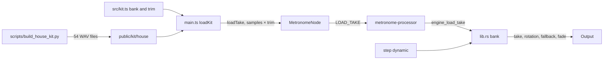

# House Kit Design

**Spec**: `.specs/features/house-kit/spec.md`
**Status**: Approved

---

## Architecture Overview

The engine picks each hit's recording on the audio thread. A new per-track bank holds 3 dynamics × 3 takes. A track with a bank uses it; a track without one plays its single sample with step gains, as today. Falling back to a single sample is therefore one line in `src/kit.ts`, which HK-25 needs.



**Approaches considered**

| Approach | Verdict |
| -------- | ------- |
| Takes chosen in Rust, on the step that plays | Chosen: on the sample clock, and `cargo test` reaches every rule |
| Takes chosen in TypeScript, swapping the loaded sample | Rejected: the worklet would race the step, and a swap would land late |
| Each take as its own hidden track | Rejected: 54 tracks in the grid, the mirror and the tick |

---

## Code Reuse Analysis

### Existing Components to Leverage

| Component | Location | How to Use |
| --------- | -------- | ---------- |
| `engine_load_sample` onset trim | `src/lib.rs:512` | Extract it, so `engine_load_take` trims the same way |
| `LOAD_SAMPLE` message | `src/audio/metronome-processor.ts:139` | Extract the copy into the heap, so `LOAD_TAKE` shares it |
| `loadSample` | `src/audio/MetronomeNode.ts:141` | Share its fetch and decode with `loadTake` |
| `loadKit` | `src/main.ts:174` | Already isolates each failure with `Promise.allSettled` |
| `completeKit` | `src/state.ts:87` | Fills tracks 11 and 12 in old presets with no change |
| `tests/fixtures/song_tabs.json` | `tests/songs.test.ts:54` | Already holds each song to its tab, so it pins Battery |

### Integration Points

| System | Integration Method |
| ------ | ------------------ |
| Rust engine | `engine_load_take(ptr, track, dynamic, take, left, right, length)` |
| WASM binary | `public/pkg/metrorig_audio_bg.wasm` is tracked, so it is rebuilt with `npm run build:wasm` |
| Saved presets | Track ids 0 to 10 are unchanged; 11 and 12 are new |

---

## Components

### House Kit builder

- **Purpose**: Turn the kit's `Blend` recordings into the 54 shipped WAV files.
- **Location**: `scripts/build_house_kit.py`
- **Interfaces**: `python3 -I scripts/build_house_kit.py <kit WAV folder> <output folder>`
- **Dependencies**: `ffmpeg`, Python standard library
- **Reuses**: the dev-tool shape of `scripts/generate_clicks.py`

Converts to 44.1 kHz, 16-bit, stereo, cuts after the last frame reaching -60 dBFS, and fades the final 5 ms. It applies no gain to the toms; Kick and Snare take their layers and one gain per piece, as AD-015 and HK-35 set. Output: `public/kit/house/<piece>/<recording>-<take>.wav`, such as `snare/crack-2.wav`. Pieces are `kick`, `snare`, `tom-10`, `tom-12`, `tom-14` and `tom-16`.

### Engine bank

- **Purpose**: Hold each track's takes and choose one per hit.
- **Location**: `src/lib.rs`
- **Interfaces**:
  - `engine_load_take(ptr, track: u32, dynamic: u32, take: u32, left, right, length)`
  - `next_source(&mut self, track: usize, step: u8) -> Option<Source>` - take, rotation and fallback
- **Dependencies**: none
- **Reuses**: the voice arrays, `step_gain`, the onset trim

Rules:
- Dynamic index: Ghost 0, Normal 1, Accent 2.
- `next_take[track][dynamic]` starts at 0, advances after each hit and survives the loop. `start()` resets it.
- Fallback looks through the takes of the dynamic from `next_take`, then the other dynamics in the order Normal, Accent, Ghost.
- A bank hit has gain 1.0. A single-sample hit keeps `step_gain`.
- `MAX_SAMPLES` is 13.

### Fading voice

- **Purpose**: End a replaced hit over 5 ms.
- **Location**: `src/lib.rs`
- **Interfaces**: internal; a retrigger on an active voice copies it to `fading[track]`.
- **Dependencies**: the engine's sample rate, for the 5 ms in frames
- **Reuses**: the drum loop in `process_tick_samples`

The fading voice adds to the mix with a linear ramp to 0. The hi-hat cutting the open hat stays a hard cut, since that hit is not on the same track. `start()` and `stop()` clear fading voices.

### Audio bridge

- **Purpose**: Carry takes from the page to the engine.
- **Location**: `src/audio/metronome-processor.ts`, `src/audio/MetronomeNode.ts`
- **Interfaces**: `loadTake(trackId, dynamic, take, url, trim)`, message `LOAD_TAKE`
- **Dependencies**: Engine bank
- **Reuses**: `loadSample`, `LOAD_SAMPLE`

`loadTake` multiplies the decoded channels by `trim`, so the engine stores the trimmed sample and needs no trim state.

### Kit rules

- **Purpose**: Declare 13 tracks, their order and their banks.
- **Location**: `src/kit.ts`
- **Interfaces**: `TRACKS`, `STADIUM_GROUPS`, `takesOf(track): { dynamic, take, url }[]`
- **Dependencies**: none
- **Reuses**: `TRACKS`

### Footer credit

- **Purpose**: Show the credit line on every screen.
- **Location**: `index.html`
- **Interfaces**: a `.status-bar` span with a link using `target="_blank"` and `rel="noopener"`
- **Dependencies**: none
- **Reuses**: the footer that all screens share

---

## Data Models

```typescript
interface Track {
  id: number;
  name: string;
  label: string;
  sample: string | null;
  bank?: {
    folder: string;                      // Under /kit/house, such as 'tom-10'
    recordings: [string, string, string]; // Ghost, Normal, Accent
    trim: number;                        // Set by ear
  };
}
```

Every new piece starts at `trim: 0.7`, the level Normal plays today, and the ear approval settles the values.

```rust
enum Source { Single, Take(usize, usize) }  // Dynamic, take

// Added to Engine
bank: [[[Option<Sample>; TAKES]; DYNAMICS]; MAX_SAMPLES],
next_take: [[usize; DYNAMICS]; MAX_SAMPLES],
playback_source: [Source; MAX_SAMPLES],
fading: [Option<FadingVoice>; MAX_SAMPLES],
```

---

## Error Handling Strategy

| Error Scenario | Handling | User Impact |
| -------------- | -------- | ----------- |
| A take fails to load | `loadKit` logs its path; the engine's bank slot stays empty | The rotation skips it |
| A dynamic has no takes | Fallback to the track's other dynamics | The hit plays another recording |
| A track has no takes | No voice starts | That track is silent, and the rest plays |

---

## Risks & Concerns

| Concern | Location (file:line) | Impact | Mitigation |
| ------- | -------------------- | ------ | ---------- |
| The first Play waits for 54 more fetches and decodes | `src/main.ts:186` | A longer pause on the first Play | The walk times it; AD-014 accepted a slower first load |
| Loading 54 samples copies on the audio thread | `src/audio/metronome-processor.ts:139` | Messages run between render quanta | Loading finishes before Play starts, so no audio plays yet |
| Peaks reach 0 dBFS and the output only clamps | `src/lib.rs:470` | Loud hits together can clip | Every piece starts at trim 0.7, and the ear approval checks a full groove |
| `TRACK_COUNT` is repeated by hand | `src/audio/metronome-processor.ts:33`, `scripts/tab_to_grid.js:7` | One left at 11 hides tracks 11 and 12 from ticks | Tests for the tick and the converter cover ids 11 and 12 |
| 13 rows make the Editor taller still | `src/index.css:530` | A longer page | AD-012 accepted it; the walk checks 390, 1024 and 1440 px |
| The engine holds one voice per track | `src/lib.rs:275` | A hit cuts its predecessor in 5 ms | Out of scope; the fade removes the click |

---

## Tech Decisions

| Decision | Choice | Rationale |
| -------- | ------ | --------- |
| Where trims live | Multiplied into the samples at load | No engine state, and ear tuning changes one number with no WASM rebuild |
| File names | Recording plus take, in lower case | Scripts and URLs need no spaces |
| Earlier samples | Stay until the ear approval, then go | HK-25 may need them; afterwards they are unused files with unconfirmed origin |
| Tail fade | 5 ms | A file cut at -60 dBFS would otherwise end on a small step |
| Grid order and ids | Order comes from the `TRACKS` array, not from ids | Renumbering Floor Tom would break saved presets; `src` never indexes `TRACKS` by id |
