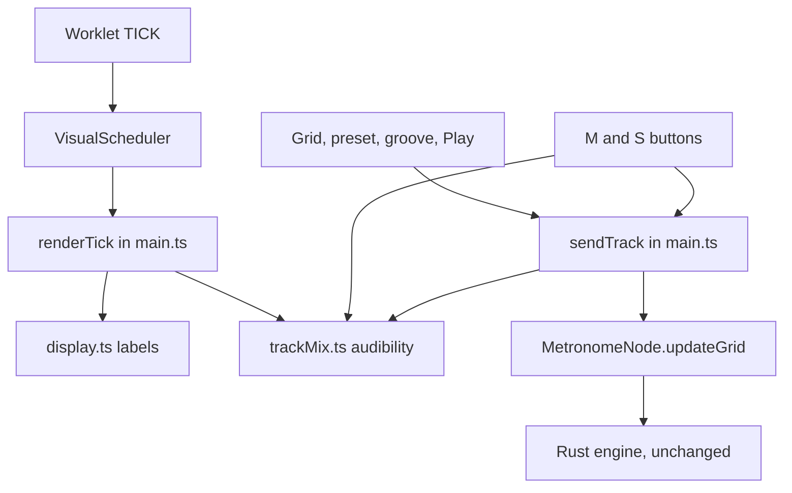

# Interface V2 Design

**Spec**: `.specs/features/interface-v2/spec.md`
**Status**: Approved

---

## Architecture Overview

The feature rebuilds `index.html` and `src/index.css`, keeps every existing element id, and adds two small rule modules that `src/main.ts` calls. There is one approach: the user fixed the stack in Q2, so no alternatives are explored.



`state.activePreset.gridData` always holds the real steps. Only `sendTrack` knows a track can be silent, so saves never see an empty grid.

---

## Code Reuse Analysis

### Existing Components to Leverage

| Component | Location | How to Use |
| --------- | -------- | ---------- |
| `drawGrid`, `drawBeatClock` | `src/main.ts:222`, `src/main.ts:311` | Extend with the new marks, label and ring shape |
| `renderTick` | `src/main.ts:531` | Add the position, bar count, latency and silent-orb filter |
| `updateTimeSignature` | `src/main.ts:435` | Steppers set the input, then call it, so limits and the alert stay in one path |
| `updateStadiumStatus` | `src/main.ts:517` | Reused for the pill text |
| `visualDelayMs` | `src/audio/MetronomeNode.ts:155` | Source of the footer latency |
| `FACTORY_GROOVES` | `src/state.ts:399` | Add `metalcore` to its id list |
| `openPage`, `tick`, `byId` | `src/index.test.ts` | Harness for every page test |

### Integration Points

| System | Integration Method |
| ------ | ------------------ |
| Worklet grid mirror | Receives the empty grid, so its `activeTrackIds` already excludes silent tracks |
| `AudioContext` | `MetronomeNode.sampleRate()` exposes the real rate |
| IndexedDB presets | Untouched: Mute and Solo never enter a `Preset` |

---

## Components

### Display rules

- **Purpose**: Turn raw values into the exact strings the screens show.
- **Location**: `src/display.ts`
- **Interfaces**:
  - `formatTimer(seconds: number): string` - `00:00:00`, with hours past 99 kept
  - `formatClock(sampleRate: number): string` - `AUDIO CLOCK: 44.1 kHz 128 SPLS (2.9ms)`
  - `formatLatency(ms: number | null): string` - `LATENCY: 12.3ms` or `LATENCY: --`
  - `formatPosition(bar: number, step: number): string` - `POS: BAR 01 · STEP 01`
  - `formatSteps(measureLength: number): string` - `STEPS: 16/32`
  - `nextDenominator(current: number, direction: 1 | -1): number` - stops at `/4` and `/16`
- **Dependencies**: None
- **Reuses**: Nothing; the logic is new and pure

### Track mix

- **Purpose**: Decide which tracks sound.
- **Location**: `src/trackMix.ts`
- **Interfaces**:
  - `createTrackMix(): TrackMix`
  - `toggleMute(mix: TrackMix, trackId: number): void`
  - `toggleSolo(mix: TrackMix, trackId: number): void`
  - `isAudible(mix: TrackMix, trackId: number): boolean`
  - `audibleSteps(mix: TrackMix, trackId: number, steps: number[]): Uint8Array`
- **Dependencies**: None
- **Reuses**: Nothing

### Page wiring

- **Purpose**: Bind the new elements.
- **Location**: `src/main.ts`
- **Interfaces**:
  - `sendTrack(trackId: number): void` - the only caller of `audioNode.updateGrid`
  - `updatePatternBar(): void` - `PAT` and `STEPS`, called from `drawGrid` and after a save
  - `updateTimers(seconds: number): void` - writes both timers
- **Dependencies**: `display.ts`, `trackMix.ts`, `MetronomeNode`
- **Reuses**: The functions in the table above

---

## Data Models

```typescript
interface TrackMix {
  muted: Set<number>;
  soloed: Set<number>;
}
```

**Relationships**: Held in one `main.ts` variable for the page's lifetime. It is not part of `Preset`.

`isAudible` returns `soloed.has(id)` when any track is soloed, otherwise `!muted.has(id)`.

The bar count is two `main.ts` variables: `currentBar` and `lastStep`. A tick whose step is not greater than `lastStep` adds one bar. Stop resets both.

---

## Error Handling Strategy

| Error Scenario | Handling | User Impact |
| -------------- | -------- | ----------- |
| Stepper passes 32 steps | `updateTimeSignature`'s existing alert and revert | Sees the existing message, value unchanged |
| Browser reports no latency | `visualDelayMs` returns 0 | Footer reads `LATENCY: 0.0ms` |
| Tick in flight after Mute | `renderTick` filters by `isAudible` | The orb stays still |
| Audio init fails | Existing behaviour | Unchanged |

---

## Risks & Concerns

| Concern | Location (file:line) | Impact | Mitigation |
| ------- | -------------------- | ------ | ---------- |
| Fragile: `src/main.ts` holds all wiring in one 838-line script | `src/main.ts:1` | Grows further | New rules live in `display.ts` and `trackMix.ts`; `main.ts` only binds |
| Fragile: `updateGrid` is called from two places | `src/main.ts:179`, `src/main.ts:287` | A missed path would unmute a track | Both go through `sendTrack`; `edge_06` covers grooves |
| Test gap: happy-dom applies no CSS | `vitest.config.ts:5` | Layout can regress unseen | Layout criteria are proven by the walk and the capture pictures |
| Tech debt: the preset grids hold 16 entries even for 12-step bars | `src/state.ts:291` | `sendTrack` must keep the array's length | `audibleSteps` returns the same length as its input |
| External: GSAP and fonts load from a CDN | `index.html:11` | Offline runs lose animation and type | Existing behaviour, unchanged |

---

## Tech Decisions

| Decision | Choice | Rationale |
| -------- | ------ | --------- |
| Denominator control | Keep the `select`, hide its arrow, add stepper buttons | Existing tests and `updateTimeSignature` keep working |
| `Trainer Active` switch | The same checkbox, restyled | Behaviour stays identical by construction |
| Clock slices | Annular sectors, replacing pie wedges under a centre disc | The capture shows gaps between rings |
| Cell width | Minimum 14px, fixed 44px height | 32 steps fit at 1440px, and the grid scrolls only when narrower |
| Trainer card open on load | CSS default open, `trainerOpen = true` | The chevron starts rotated through `gsap.set` |
| Latency refresh | On every tick at step 0 | Enough for a slow value, and no text write on every step |
