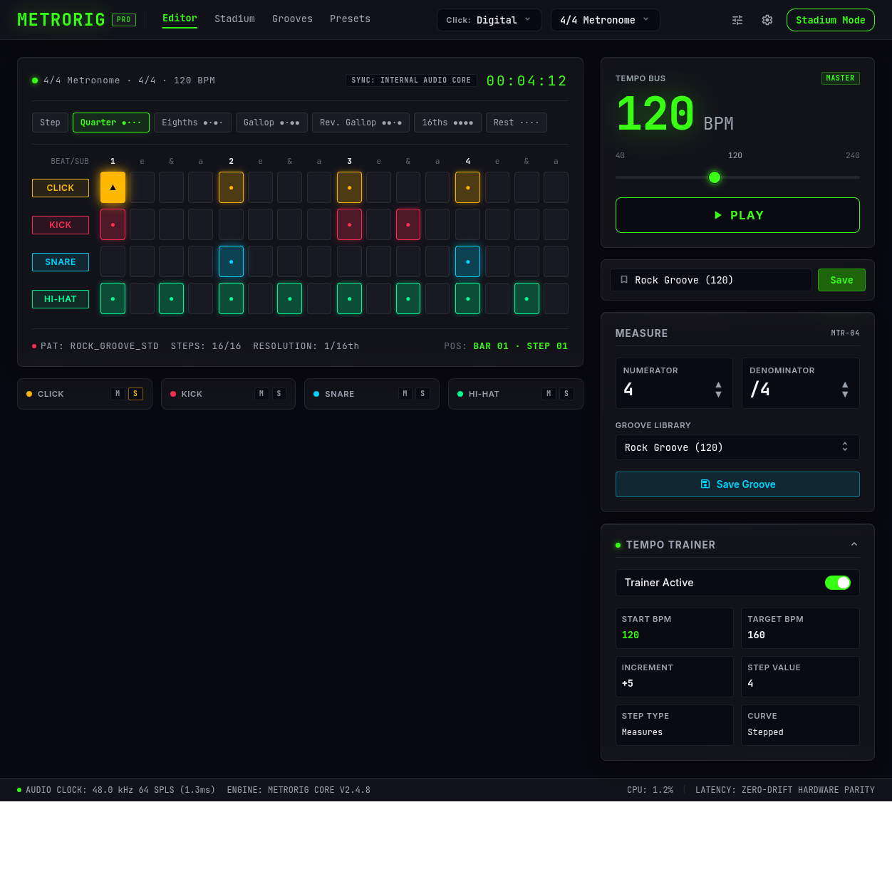
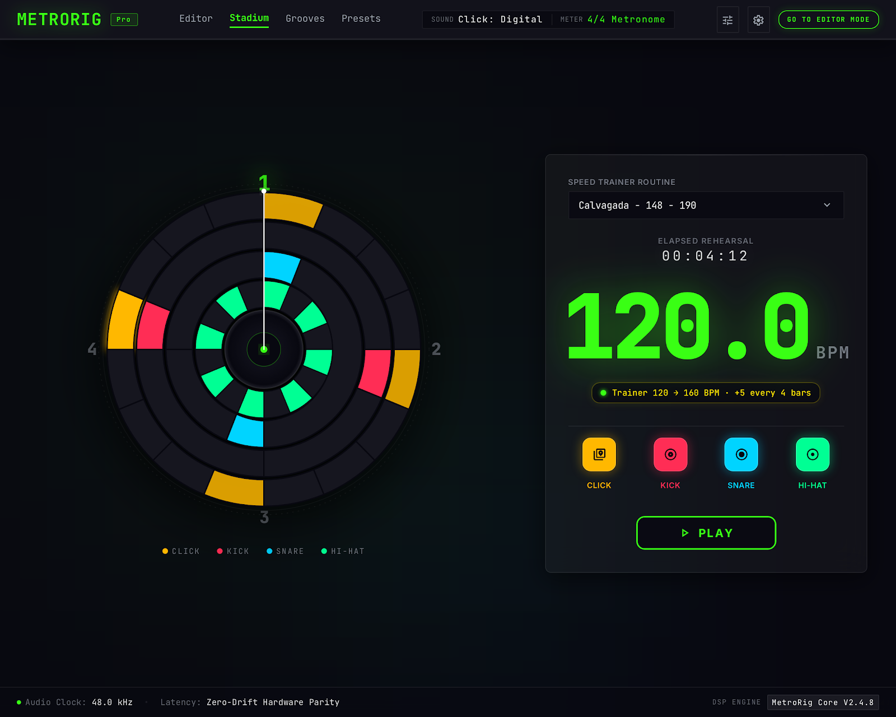

# Interface V2 Specification

**Approved**: 2026-10-31 - user: "aprovado"

## Problem Statement

Stitch proposed a new interface for MetroRig: a DAW rack unit for editing and a stage-readable practice view. The current screens share its tokens but not its composition, and they lack Mute/Solo, a live position, a shared timer and any layout for narrow windows. The PRD also asks for things the product doesn't have or already has, so this spec takes the visual design and keeps the engine and the real data.

## Goals

- [ ] The Editor and Stadium screens match `captures/editor.png` and `captures/stadium.png`, apart from the approved differences
- [ ] Every value on screen is real
- [ ] Each track can be muted and soloed without touching presets or the engine
- [ ] The Editor works at 1440, 1024 and 390px wide
- [ ] Every existing control keeps working, and every existing test still passes

## Out of Scope

| Feature | Reason |
| ------- | ------ |
| Tailwind, a store library, routes | The user kept the current stack |
| `requestAnimationFrame` visual loop | Tick sync with output-latency delay stays |
| Rust engine and WASM changes | PRD Phase 4 is already built and proven in `precise-only` |
| CPU monitor, engine version, sync source | No such data exists |
| Grooves and Presets pages, settings and calibration | No such features exist |
| Clickable orbs | They would be a new function |
| Saving Mute/Solo in presets | The user chose session-only |
| Moving playhead on the grid | Not drawn in the capture; `POS` shows the position |
| Replacing native `alert` and `prompt` dialogs | Not drawn in the captures |
| Swing | Removed on purpose by `precise-only` |

---

## Assumptions & Open Questions

Every ambiguity is resolved or recorded here - nothing is left silently unclear.

| Assumption / decision | Chosen default | Rationale | Confirmed? |
| --------------------- | --------------- | --------- | ---------- |
| White band under `editor.png` | Export artifact, ignored | The page background fills the window | y |
| Play shape | Rounded rectangle in both modes | Both captures draw it; the PRD's pill loses | y |
| Tempo Trainer card on load | Expanded | The capture draws it open | y |
| Trainer status with the Trainer off | Same pill, reads `Trainer Off` | Existing copy | y |
| Sequencer header dot | Lit while playing, unlit when stopped | Gives the dot a meaning | y |
| `POS` when stopped | `BAR 01 · STEP 01` | Capture copy | y |
| Latency before the first Play | `--` | No value exists yet | y |
| Footer latency value | Base plus output latency, as `visualDelayMs` computes it | The app's existing definition | y |
| Middle slider label | Current slider BPM | The capture's 120 is the set value | y |
| Capture icons | Drawn as inline SVG, no Material Symbols font | Same look, no new external dependency | y |
| Bar count | Counts completed wraps since Play, resets on Stop | No bar counter exists today | y |
| Docs | `.stitch/DESIGN.md` updated at the end | Its Known Drift list goes stale | y |

**Open questions:** none - all resolved or logged above (required before the spec is confirmed).

---

## User Stories

### P1: Rack shell ⭐ MVP

**User Story**: As a musician, I want one header and footer in both modes so that the app reads as a single instrument.

**Why P1**: Both screens sit inside it.

**Acceptance Criteria**:

1. SHELL-01: The header SHALL show the `METRORIG` logo with a `PRO` badge, the click sound selector, the preset selector and the view toggle, in both modes.
2. SHELL-02: The header SHALL NOT show the links `Editor`, `Stadium`, `Grooves` or `Presets`, or the `tune` and `settings` icons.
3. SHELL-03: The preset selector SHALL keep the groups `Time Signatures`, `Drum Grooves`, `Speed Trainer` and `User Presets`.
4. SHELL-04: WHILE in Editor mode the view toggle SHALL read `GO TO STADIUM MODE`.
5. SHELL-05: WHILE in Stadium mode the view toggle SHALL read `GO TO EDITOR MODE`.
6. SHELL-06: The footer SHALL show `AUDIO CLOCK: <rate> kHz 128 SPLS (<buffer>ms)` from the audio context's sample rate, which reads `AUDIO CLOCK: 44.1 kHz 128 SPLS (2.9ms)` at 44100 Hz.
7. SHELL-07: WHEN playback has started THEN the footer SHALL show `LATENCY: <value>ms`, using the latency the browser reports.
8. SHELL-08: IF playback has not started since the page loaded THEN the footer SHALL show `LATENCY: --`.
9. SHELL-09: The footer SHALL NOT show an engine version, a CPU value or `Hardware Parity`.

**Independent Test**: Load the page, switch modes, and read the header and footer.

---

### P1: Editor Mode ⭐ MVP

**User Story**: As a musician, I want the rack-style Editor so that I can build a bar and read its state at a glance.

**Why P1**: It is the first screen in the app and the product's lead feature.

**Acceptance Criteria**:

1. EDIT-01: WHEN the app opens in Editor mode with a modified preset THEN the system SHALL show the layout in `.specs/features/interface-v2/captures/editor.png`.
2. EDIT-02: WHEN the app opens THEN the sequencer header SHALL read `4/4 Metronome  ·  4/4  ·  120 BPM`.
3. EDIT-03: WHILE playing the sequencer header dot SHALL be lit.
4. EDIT-04: WHILE stopped the sequencer header dot SHALL be unlit.
5. EDIT-05: The count row SHALL start with a `BEAT/SUB` label in the track label column.
6. EDIT-06: WHEN a step holds a hit THEN its cell SHALL show a centred dot in the track colour.
7. EDIT-07: WHEN a step holds an accent THEN its cell SHALL show a solid track colour fill and a `▲` mark.
8. EDIT-08: The grid SHALL keep the wider gap between beats.
9. EDIT-09: The grid SHALL keep the sustain state for a step that follows a hit in a beat with two or more hits.
10. EDIT-10: The pattern bar SHALL read `PAT: <preset name>`.
11. EDIT-11: The pattern bar SHALL read `STEPS: <measure length>/32`, which is `STEPS: 16/32` for 4/4.
12. EDIT-12: The pattern bar SHALL read `RESOLUTION: 1/16th`.
13. EDIT-13: WHILE stopped the pattern bar SHALL read `POS: BAR 01 · STEP 01`.
14. EDIT-14: WHEN a tick renders during playback THEN the pattern bar SHALL show that tick's bar and step, each with two digits.
15. EDIT-15: WHEN the step position wraps to step 1 during playback THEN the bar number SHALL increase by one.
16. EDIT-16: The BPM card SHALL be titled `TEMPO BUS`, with no `MASTER` badge.
17. EDIT-17: The BPM slider SHALL show `40` and `240` at its ends and the current BPM between them.
18. EDIT-18: WHEN the user moves the BPM slider THEN the middle label SHALL show the new BPM.
19. EDIT-19: The `MEASURE` card SHALL NOT show `MTR-04`.
20. EDIT-20: WHEN the user presses a Numerator stepper THEN the numerator SHALL change by 1, within 1 to 16, through the existing time signature path.
21. EDIT-21: WHEN the user presses a Denominator stepper THEN the denominator SHALL move through `/4`, `/8` and `/16`, stopping at each end.
22. EDIT-22: The groove selector SHALL be labelled `Groove Library`.
23. EDIT-23: The groove library SHALL list `Rock Groove`, `Metal Groove`, `Blues Shuffle`, `Jazz Swing` and `Metalcore Breakdown`, with no BPM in the name.
24. EDIT-24: WHEN the user applies `Metalcore Breakdown` THEN the Kick, Snare and Hi-hat tracks SHALL take that preset's parts, and the BPM SHALL NOT change.
25. EDIT-25: WHEN the page loads THEN the Tempo Trainer card SHALL be expanded.
26. EDIT-26: WHEN the user uses the `Trainer Active` switch THEN the Trainer SHALL turn on or off exactly as the current checkbox does.
27. EDIT-27: WHILE the Trainer is active its card dot SHALL be shown steady, with no pulsing animation.
28. EDIT-28: WHEN the user edits the bar THEN the Save Toast SHALL appear as it does today.
29. EDIT-29: IF nothing has been edited since the last preset load THEN the Save Toast SHALL stay hidden.

**Independent Test**: Load Rock Groove, press Play, and compare the screen with `captures/editor.png`.

---

### P1: Stadium Mode ⭐ MVP

**User Story**: As a musician, I want the rebuilt Stadium so that I can read the tempo and the bar from across the room.

**Why P1**: It is the practice half of the product.

**Acceptance Criteria**:

1. STAD-01: WHEN the user opens Stadium mode with a speed trainer loaded THEN the system SHALL show the layout in `.specs/features/interface-v2/captures/stadium.png`.
2. STAD-02: The beat clock SHALL show one ring per track, outside in: Click, Kick, Snare, Hi-hat.
3. STAD-03: The beat clock SHALL show a legend with `CLICK`, `KICK`, `SNARE` and `HI-HAT` in track colours.
4. STAD-04: The readout panel SHALL label its selector `SPEED TRAINER ROUTINE`.
5. STAD-05: The readout panel SHALL label its timer `ELAPSED REHEARSAL`.
6. STAD-06: The tempo SHALL show one decimal with a `BPM` unit.
7. STAD-07: WHILE the Trainer is on the status pill SHALL read as `Trainer 120 → 160 BPM · +5 every 4 bars`, using the Trainer's values.
8. STAD-08: WHILE the Trainer is off the status pill SHALL read `Trainer Off`.
9. STAD-09: Each orb SHALL show a rounded square in its track colour, with an icon and its track name.
10. STAD-10: WHEN a hit of an audible track renders THEN its orb SHALL scale from 1.15 to 1.0 in 0.2s without changing colour.
11. STAD-11: Clicking an orb SHALL change nothing.
12. STAD-12: Every beat clock and tick behaviour of the current Stadium SHALL keep working: lit slices, sustain slices, active beat numeral, sweeping hand.

**Independent Test**: Load `Calvagada - 148 - 190`, open Stadium, press Play, and compare with `captures/stadium.png`.

---

### P1: Shared timer ⭐ MVP

**User Story**: As a musician, I want one session timer in both modes so that I can see how long I've practised.

**Why P1**: Both captures draw it.

**Acceptance Criteria**:

1. TIME-01: The timer SHALL use `HH:MM:SS` and start at `00:00:00`.
2. TIME-02: The timer SHALL be visible in Editor and Stadium modes.
3. TIME-03: WHEN the user presses Play THEN the timer SHALL restart from `00:00:00`.
4. TIME-04: WHEN the user presses Stop THEN the timer SHALL keep its last value.
5. TIME-05: IF a session passes 99:59:59 THEN the hours SHALL keep counting.
6. TIME-06: WHEN the user switches modes during playback THEN both modes SHALL show the same time.

**Independent Test**: Play for 3 seconds, switch modes, stop, and read the timer.

---

### P2: Mute and Solo

**User Story**: As a musician, I want to silence or isolate tracks so that I can practise against part of a groove.

**Why P2**: It is new behaviour the screens can ship without.

**Acceptance Criteria**:

1. MUTE-01: The Editor SHALL show an `M` and an `S` control for each track.
2. MUTE-02: WHEN the user presses `M` on a track THEN that track SHALL stop sounding.
3. MUTE-03: WHEN the user presses an active `M` THEN that track SHALL sound again.
4. MUTE-04: WHEN any track is soloed THEN only soloed tracks SHALL sound.
5. MUTE-05: WHEN the user solos a second track THEN both tracks SHALL sound.
6. MUTE-06: WHILE a track is both muted and soloed it SHALL sound.
7. MUTE-07: WHILE a track is silenced its row SHALL be dimmed.
8. MUTE-08: WHILE a track is silenced its orb SHALL NOT react to ticks.
9. MUTE-09: WHEN the user edits a silenced track THEN the edit SHALL be kept and stay silent until the track is audible.
10. MUTE-10: WHEN the user saves a preset or a groove with a silenced track THEN the saved grid SHALL hold the real steps.
11. MUTE-11: WHEN the user loads a preset or applies a groove THEN Mute and Solo SHALL stay as they were.
12. MUTE-12: WHEN Play starts THEN the engine SHALL receive empty grids for silenced tracks.
13. MUTE-13: WHEN the page reloads THEN no track SHALL be muted or soloed.

**Independent Test**: Load Rock Groove, mute Kick, press Play, load Metal Groove, and confirm Kick stays silent.

---

### P2: Narrow windows

**User Story**: As a musician, I want the app to fit a small window so that I can use it on a laptop split screen or a phone.

**Why P2**: The captures are desktop only.

**Acceptance Criteria**:

1. RESP-01: WHILE the window is at least 1024px wide the Editor SHALL use two columns.
2. RESP-02: WHILE the window is under 1024px wide the Editor SHALL stack the controls under the sequencer.
3. RESP-03: WHILE the window is 390px wide the page SHALL NOT scroll horizontally.
4. RESP-04: IF the grid doesn't fit its panel THEN only the grid SHALL scroll horizontally.
5. RESP-05: WHILE the window is under 1024px wide the Stadium SHALL stack the beat clock above the readout.
6. RESP-06: WHILE the window is 390px wide the header SHALL keep every control reachable.
7. RESP-07: WHEN the bar has 32 steps at 1440px wide THEN every step cell SHALL fit without horizontal scrolling.

**Independent Test**: Resize to 1440, 1024 and 390px in both modes.

---

### P3: Design document

**User Story**: As a maintainer, I want `.stitch/DESIGN.md` to describe the shipped interface so that later Stitch work starts from the truth.

**Why P3**: It carries no user-visible behaviour.

**Acceptance Criteria**:

1. DOCS-01: WHEN the interface ships THEN `.stitch/DESIGN.md` SHALL describe the new header, footer, cells, orbs and Mute/Solo controls.
2. DOCS-02: WHEN the interface ships THEN `.stitch/DESIGN.md` SHALL drop every Known Drift item this feature fixes.

---

## Edge Cases

- EDGE-01: IF the user steps the numerator past 32 steps THEN the system SHALL show the existing limit message and keep the previous value.
- EDGE-02: WHEN the bar changes length during playback THEN `STEPS` SHALL show the new length on the same change.
- EDGE-03: WHEN the user stops playback THEN `POS` SHALL return to `BAR 01 · STEP 01`.
- EDGE-04: IF the active preset is not a speed trainer THEN the Stadium selector SHALL show `Choose a speed trainer`.
- EDGE-05: IF every track is muted THEN playback, the hand, the timer and `POS` SHALL continue with no sound.
- EDGE-06: WHEN the user applies a groove while a track is silenced THEN the engine SHALL keep receiving an empty grid for it.

---

## Requirement Traceability

| Requirement ID | Story | Phase | Status |
| -------------- | ----- | ----- | ------ |
| SHELL-01 | P1: Rack shell | Tasks | Implementing |
| SHELL-02 | P1: Rack shell | Tasks | Implementing |
| SHELL-03 | P1: Rack shell | Tasks | Implementing |
| SHELL-04 | P1: Rack shell | Tasks | Implementing |
| SHELL-05 | P1: Rack shell | Tasks | Implementing |
| SHELL-06 | P1: Rack shell | Tasks | Implementing |
| SHELL-07 | P1: Rack shell | Tasks | Implementing |
| SHELL-08 | P1: Rack shell | Tasks | Implementing |
| SHELL-09 | P1: Rack shell | Tasks | Implementing |
| EDIT-01 | P1: Editor Mode | Tasks | Implementing |
| EDIT-02 | P1: Editor Mode | Tasks | Implementing |
| EDIT-03 | P1: Editor Mode | Tasks | Implementing |
| EDIT-04 | P1: Editor Mode | Tasks | Implementing |
| EDIT-05 | P1: Editor Mode | Tasks | Implementing |
| EDIT-06 | P1: Editor Mode | Tasks | Implementing |
| EDIT-07 | P1: Editor Mode | Tasks | Implementing |
| EDIT-08 | P1: Editor Mode | Tasks | Implementing |
| EDIT-09 | P1: Editor Mode | Tasks | Implementing |
| EDIT-10 | P1: Editor Mode | Tasks | Implementing |
| EDIT-11 | P1: Editor Mode | Tasks | Implementing |
| EDIT-12 | P1: Editor Mode | Tasks | Implementing |
| EDIT-13 | P1: Editor Mode | Tasks | Implementing |
| EDIT-14 | P1: Editor Mode | Tasks | Implementing |
| EDIT-15 | P1: Editor Mode | Tasks | Implementing |
| EDIT-16 | P1: Editor Mode | Tasks | Implementing |
| EDIT-17 | P1: Editor Mode | Tasks | Implementing |
| EDIT-18 | P1: Editor Mode | Tasks | Implementing |
| EDIT-19 | P1: Editor Mode | Tasks | Implementing |
| EDIT-20 | P1: Editor Mode | Tasks | Implementing |
| EDIT-21 | P1: Editor Mode | Tasks | Implementing |
| EDIT-22 | P1: Editor Mode | Tasks | Implementing |
| EDIT-23 | P1: Editor Mode | Tasks | Implementing |
| EDIT-24 | P1: Editor Mode | Tasks | Implementing |
| EDIT-25 | P1: Editor Mode | Tasks | Implementing |
| EDIT-26 | P1: Editor Mode | Tasks | Implementing |
| EDIT-27 | P1: Editor Mode | Tasks | Implementing |
| EDIT-28 | P1: Editor Mode | Tasks | Implementing |
| EDIT-29 | P1: Editor Mode | Tasks | Implementing |
| STAD-01 | P1: Stadium Mode | Tasks | Implementing |
| STAD-02 | P1: Stadium Mode | Tasks | Implementing |
| STAD-03 | P1: Stadium Mode | Tasks | Implementing |
| STAD-04 | P1: Stadium Mode | Tasks | Implementing |
| STAD-05 | P1: Stadium Mode | Tasks | Implementing |
| STAD-06 | P1: Stadium Mode | Tasks | Implementing |
| STAD-07 | P1: Stadium Mode | Tasks | Implementing |
| STAD-08 | P1: Stadium Mode | Tasks | Implementing |
| STAD-09 | P1: Stadium Mode | Tasks | Implementing |
| STAD-10 | P1: Stadium Mode | Tasks | Implementing |
| STAD-11 | P1: Stadium Mode | Tasks | Implementing |
| STAD-12 | P1: Stadium Mode | Tasks | Implementing |
| TIME-01 | P1: Shared timer | Tasks | Implementing |
| TIME-02 | P1: Shared timer | Tasks | Implementing |
| TIME-03 | P1: Shared timer | Tasks | Implementing |
| TIME-04 | P1: Shared timer | Tasks | Implementing |
| TIME-05 | P1: Shared timer | Tasks | Implementing |
| TIME-06 | P1: Shared timer | Tasks | Implementing |
| MUTE-01 | P2: Mute and Solo | Tasks | Implementing |
| MUTE-02 | P2: Mute and Solo | Tasks | Implementing |
| MUTE-03 | P2: Mute and Solo | Tasks | Implementing |
| MUTE-04 | P2: Mute and Solo | Tasks | Implementing |
| MUTE-05 | P2: Mute and Solo | Tasks | Implementing |
| MUTE-06 | P2: Mute and Solo | Tasks | Implementing |
| MUTE-07 | P2: Mute and Solo | Tasks | Implementing |
| MUTE-08 | P2: Mute and Solo | Tasks | Implementing |
| MUTE-09 | P2: Mute and Solo | Tasks | Implementing |
| MUTE-10 | P2: Mute and Solo | Tasks | Implementing |
| MUTE-11 | P2: Mute and Solo | Tasks | Implementing |
| MUTE-12 | P2: Mute and Solo | Tasks | Implementing |
| MUTE-13 | P2: Mute and Solo | Tasks | Implementing |
| RESP-01 | P2: Narrow windows | Tasks | Implementing |
| RESP-02 | P2: Narrow windows | Tasks | Implementing |
| RESP-03 | P2: Narrow windows | Tasks | Implementing |
| RESP-04 | P2: Narrow windows | Tasks | Implementing |
| RESP-05 | P2: Narrow windows | Tasks | Implementing |
| RESP-06 | P2: Narrow windows | Tasks | Implementing |
| RESP-07 | P2: Narrow windows | Tasks | Implementing |
| DOCS-01 | P3: Design document | Tasks | Pending |
| DOCS-02 | P3: Design document | Tasks | Pending |
| EDGE-01 | Edge Cases | Tasks | Implementing |
| EDGE-02 | Edge Cases | Tasks | Implementing |
| EDGE-03 | Edge Cases | Tasks | Implementing |
| EDGE-04 | Edge Cases | Tasks | Implementing |
| EDGE-05 | Edge Cases | Tasks | Implementing |
| EDGE-06 | Edge Cases | Tasks | Implementing |

**ID format:** `[CATEGORY]-[NUMBER]`

**Status values:** Pending → In Design → In Tasks → Implementing → Verified

**Coverage:** 84 total, 0 mapped to tasks, 84 unmapped ⚠️ (tasks not written yet)

---

## Differences from the source

| Source shows | Product shows | Confirmed |
| ------------ | ------------- | --------- |
| Links `Editor`, `Stadium`, `Grooves`, `Presets` | Nothing | y - AD-001 |
| `tune` and `settings` icons | Nothing | y - AD-001 |
| "Meter" selector with time signatures | Full preset selector, no `METER` label | y - AD-001 |
| Stadium's joined `SOUND` and `METER` selector | Two separate selectors, as in the Editor | y - AD-005 |
| `Pro` in Stadium | `PRO` | y - AD-005 |
| `Stadium Mode` in the Editor toggle | `GO TO STADIUM MODE` | y - AD-005 |
| `SYNC: INTERNAL AUDIO CORE` | Nothing | y - AD-002 |
| `MASTER` badge | Nothing | y - AD-002 |
| `MTR-04` | Nothing | y - AD-002 |
| `PAT: ROCK_GROOVE_STD` | `PAT: <preset name>` | y - AD-002 |
| `STEPS: 16/16` | `STEPS: 16/32` | y - AD-002 |
| `48.0 kHz 64 SPLS (1.3ms)` | Real rate and 128-frame buffer | y - AD-002 |
| `ENGINE: METRORIG CORE V2.4.8` | Nothing | y - AD-002 |
| `CPU: 1.2%` | Nothing | y - AD-002 |
| `LATENCY: ZERO-DRIFT HARDWARE PARITY` | `LATENCY: <value>ms` | y - AD-002 |
| `Rock Groove (120)` in the groove library | `Rock Groove` | y - AD-004 |
| Equal gaps across the grid | Wider gap between beats | y - AD-003 |
| No sustain state | Sustain state kept | y - AD-003 |

## Sources

- `prd.md` - the Stitch PRD: scope, labels and behaviour, where the captures and decisions don't override it
- `context.md` - the user's answers to both discussion rounds
-  - binding - Editor Mode, 1252x1227, with Rock Groove and a modified preset
-  - binding - Practice Stadium Mode, 1600x1280, with a speed trainer running
- `.specs/features/precise-only/` - the engine behaviour this feature leaves untouched

---

## Success Criteria

- [ ] `captures/editor.running.png` and `captures/stadium.running.png` match their captures apart from `## Differences from the source`
- [ ] `npm run test:js` and `npm run test:rust` pass
- [ ] `public/pkg/metrorig_audio_bg.wasm` is byte-identical to the current file
