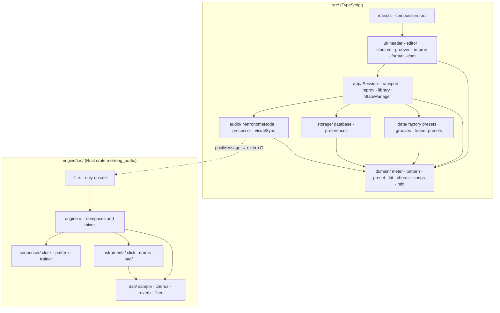

# Layered Architecture Design

**Spec**: `.specs/features/layered-architecture/spec.md`
**Status**: Approved

---

## Architecture Overview

Two layer stacks, each depending only downward. The WASM seam between them does not move: the same `extern "C"` names, the same worklet messages.



**Rule.** `domain` imports nothing from `src/`. `data`, `storage` and `audio` import only `domain`. `app` imports `domain`, `data`, `storage`, `audio`. `ui` imports `app` and `domain`. Only `main.ts` imports `ui`. In Rust: `dsp` and `sequencer` use no crate module, `instruments` uses `dsp`, `engine` uses `sequencer`, `instruments`, `dsp`, and `ffi` uses `engine`.

**Where the rules run.** Every rule that changes what a user sees today in `main.ts` - loading a preset, resizing the grid on a meter change, applying a figure or a groove, mute and solo, the bar in play and the position counter, songs replacing edits, the chord state and the pad notice - moves to `app/` or `domain/`, which `tests/app/session.test.ts` reaches without a DOM. `ui/` reads Session state and renders it.

---

## Code Reuse Analysis

### Existing Components to Leverage

| Component | Location | How to Use |
| --------- | -------- | ---------- |
| `Engine`, FFI exports | `src/lib.rs` | Split by responsibility; code moves, it is not rewritten |
| `Pad`, `Chorus`, `Reverb`, `Comb`, `AllPass`, `low_pass`, `read` | `src/pad.rs` | DSP primitives move to `dsp/`, voices and slots to `instruments/pad/` |
| Black-box FFI harness `Run` | `src/lib.rs` tests | Stays the harness of the FFI tests and drives the golden test |
| `StateManager` | `src/state.ts` | Keeps its interface in `app/stateManager.ts`; its IndexedDB and `localStorage` code moves to `storage/` |
| `MetronomeNode` | `src/audio/MetronomeNode.ts` | Satisfies the Session's `EnginePort` unchanged |
| `VisualScheduler` | `src/visualSync.ts` | Moves to `audio/visualSync.ts`; the Session delays ticks with it |
| Pure helpers in `bars`, `kit`, `chords`, `songs`, `trackMix`, `display` | `src/*.ts` | Move as they are into `domain/` (and `display` into `ui/format.ts`) |
| `main.ts` logic | `src/main.ts` | Rules move into the Session unchanged in effect; DOM code moves into `ui/` screens |

### Integration Points

| System | Integration Method |
| ------ | ------------------ |
| WASM build | `build:wasm` becomes `cargo build --manifest-path engine/Cargo.toml --target wasm32-unknown-unknown --release && node scripts/copy_wasm.js`; `copy_wasm.js` reads `engine/target/wasm32-unknown-unknown/release/metrorig_audio.wasm` |
| Rust tests | `test:rust` becomes `cargo test --manifest-path engine/Cargo.toml` |
| Python fixtures | `tests/fixtures/pad_files.py` reads `src/domain/chords.ts` |
| `index.html` | Still loads `./src/main.ts` |

---

## Components

### Rust: `dsp/`

- **Purpose**: Sound primitives with no knowledge of tracks or notes.
- **Location**: `engine/src/dsp/{mod,sample,chorus,reverb,filter}.rs`
- **Interfaces**:
  - `Sample { left, right }`, `trim_onset(left, right) -> Sample`
  - `Chorus::new(rate) / run(l, r) -> (f32, f32) / clear()`; `Reverb` the same, with `Comb` and `AllPass` private to `reverb.rs`
  - `low_pass(poles, input, smoothing)`
- **Dependencies**: none in the crate
- **Reuses**: `pad.rs:233-353, 621`; `lib.rs:21-24, 185-197`

### Rust: `sequencer/`

- **Purpose**: When steps fall, what each step holds, and how the Trainer moves the tempo.
- **Location**: `engine/src/sequencer/{mod,clock,pattern,trainer}.rs`
- **Interfaces**:
  - `Clock { bpm, samples_per_step, ... }`: `new(sample_rate)`, `set_bpm(bpm)`, `start()`, `advance() -> bool` (true when a step is due, `first_hit` included), `is_first_hit()`
  - `Pattern`: `update_grid(track, steps) -> bool`, `set_measure_length(len) -> bool`, `set_bars(bars) -> bool`, `restart()`, `step(track) -> u8`, `is_bar_start()`, `advance()`, `index()`; `pub const TRACKS: usize = 13`
  - `Trainer`: `set(settings, playing)`, `replace(settings, playing)`, `on_start() -> Option<f64>`, `on_bar_start(first, bpm, sample_rate) -> Option<f64>`, `on_frame(bpm, samples_per_step, measure_length, sample_rate) -> Option<f64>`; `TrainerSettings::new(...) -> Option<Self>` validates the values, `StepType`, `Curve`
- **Dependencies**: none in the crate
- **Reuses**: `lib.rs:41-113, 279-286, 288-307, 389-492`. Float operations keep their order and operands (`samples_per_step * measure_length * step_value`) so the output stays bit for bit.

### Rust: `instruments/`

- **Purpose**: The voices that turn a step into sound.
- **Location**: `engine/src/instruments/{mod,click,drums}.rs`, `engine/src/instruments/pad/{mod,voice,slot,mixes}.rs`
- **Interfaces**:
  - `Click`: `new(sample_rate)`, `set_mode(mode)`, `load(sample)`, `trigger(step)`, `reset()`, `render() -> (f32, f32)`
  - `Drums`: `new(sample_rate)`, `load_sample(track, sample)`, `load_take(track, dynamic, take, sample)`, `trigger(track, step)`, `choke(track)`, `reset()`, `stop()`, `render() -> (f32, f32)`; `pub const TRACKS: usize = 13`
  - `Pad`: unchanged interface (`play`, `stop`, `load`, `load_begin`, `load_end`, `set_volume`, `is_silent`, `mix_into`), AD-017
- **Dependencies**: `dsp`
- **Reuses**: `lib.rs:5-16, 26-39, 168-183, 313-387, 518-580`; `pad.rs` whole

### Rust: `engine.rs`

- **Purpose**: Composes the clock, the pattern, the Trainer and the instruments, and mixes one block.
- **Location**: `engine/src/engine.rs`
- **Interfaces**: `Engine::new(sample_rate)`, `start()`, `stop()`, `set_bpm(bpm)`, `load_sample(id, l, r)` (id 0 is the click), `load_take(...)`, `update_grid(...)`, `set_measure_length(..)`, `set_bars(..)`, `restart_pattern()`, `set_trainer(..)`, `replace_trainer(..)`, `set_click_mode(..)`, `pad_mut()`, `tick() -> (i32, f64)`, `fill_buffers(l, r)`. A `const _: () = assert!(pattern::TRACKS == drums::TRACKS)` ties the two track counts.
- **Dependencies**: `sequencer`, `instruments`, `dsp`
- **Reuses**: `lib.rs:114-166, 198-596`

### Rust: `ffi.rs`

- **Purpose**: The WASM seam: raw pointers in, `Engine` calls out. The only file with `unsafe` outside tests.
- **Location**: `engine/src/ffi.rs`, its tests in `engine/src/ffi_tests.rs` (`#[cfg(test)] #[path = "ffi_tests.rs"] mod tests;`)
- **Interfaces**: the 25 `#[no_mangle] extern "C"` functions, names and signatures unchanged; `StepType`/`Curve` decoding from `u32`
- **Dependencies**: `engine`
- **Reuses**: `lib.rs:598-837`

### Rust: golden test

- **Purpose**: Proves the output is bit-identical to commit `591f031`.
- **Location**: `engine/src/golden_tests.rs` (created as `src/golden_tests.rs` before the move), declared from `lib.rs` under `#[cfg(test)]`
- **Interfaces**: six `#[test]` functions, one per scenario (`drums_with_takes_and_dynamics`, `synth_click`, `sample_click`, `trainer_stepped_by_bars`, `trainer_smooth_by_seconds`, `pad_changes_chord_and_timbre`), each rendering 4 s at 44100 Hz in 128-frame blocks through the `extern "C"` functions, and a `fingerprint` helper: FNV-1a 64 over `to_bits()` of left then right of every frame. `compare(scenario, actual, expected)` panics with the scenario's name; a seventh test feeds it a 1-bit change.
- **Dependencies**: only the `extern "C"` functions, so the file moves without edits
- **Reuses**: synthetic samples built from a fixed LCG, so the test needs no file

### TypeScript: `domain/`

- **Purpose**: The music and pattern rules, with no I/O.
- **Location**: `src/domain/{meter,pattern,preset,kit,chords,songs,mix}.ts`
- **Interfaces**: `meter.ts` - `getBeatsPerMeasure`, `measureLengthFor`, `getBeatForStep`, `isSustainedStep`, `measureLengthToTimeSig`; `pattern.ts` - `bars.ts` functions, `FIGURES`, `applyFigure`, `resizeToBar`, `grooveBar`; `preset.ts` - `Preset`, `StoredPreset`, `TrainerSettings`, `normalizePreset`, `completeKit`, `startBpmFor`; `kit.ts`, `chords.ts`, `songs.ts` as today; `mix.ts` - today's `trackMix.ts`
- **Dependencies**: none

### TypeScript: `data/`

- **Purpose**: Factory content.
- **Location**: `src/data/factory.ts` - `FACTORY_PRESETS`, `FACTORY_GROOVES`, `SPEED_TRAINER_PRESETS`
- **Dependencies**: `domain`

### TypeScript: `storage/`

- **Purpose**: What survives a reload.
- **Location**: `src/storage/database.ts` (IndexedDB `metrorig_db` v2: presets, practice logs, grooves), `src/storage/preferences.ts` (`localStorage` keys `metrorig_view_mode`, `metrorig_click_sound`, `metrorig_pad_timbre`, `metrorig_pad_volume`)
- **Dependencies**: `domain`

### TypeScript: `audio/`

- **Purpose**: The adapter to the AudioWorklet and the WASM engine.
- **Location**: `src/audio/{MetronomeNode,metronome-processor,visualSync}.ts`
- **Dependencies**: `domain`

### TypeScript: `app/`

- **Purpose**: Every rule `main.ts` runs today, behind one Session the screens call.
- **Location**: `src/app/{session,transport,improv,library,stateManager,ports}.ts`
- **Interfaces**:
  - `ports.ts`: `EnginePort` (the `MetronomeNode` methods `main.ts` calls, plus `addEventListener('tick')`), `Dialogs { confirm(message): boolean }`, `Preferences`
  - `StateManager`: today's interface unchanged, persistence delegated to `storage/`
  - `Session`: `new Session({ engine, state, prefs, dialogs, wasmUrl, workletUrl })`; reads - `preset`, `isPlaying`, `isStarting`, `viewBar`, `playBar`, `position`, `mix`, `figure`, `hasUnsavedEdits`, `selectedPresetValue`, `improv`; `subscribe(listener: (change: SessionChange) => void)`; commands - `togglePlay`, `setBpm`, `setTimeSignature(num, den)` returning `'changed' | 'too-long' | 'declined' | 'unchanged'`, `editStep(trackId, step)`, `selectFigure`, `showBar`, `loadPreset(value)`, `savePreset(name)`, `applyGroove(value)`, `saveGroove(name)`, `useSong`, `playSong`, `toggleMute`, `toggleSolo`, `setTrainer(settings)`, `setClickSound`, `setView`, `pressChord`, `stopChord`, `setTimbre`, `setPadVolume`
  - `transport.ts` (engine start-up with retry, kit load, click sound, sync to the engine, play/stop, ticks delayed by `VisualScheduler`, bar and position), `improv.ts` (chord state, timbre load queue, notice), `library.ts` (factory, song and user preset lookup, grooves): internal seams of the Session, not imported by `ui/`
- **Dependencies**: `domain`, `data`, `storage`, `audio`

### TypeScript: `ui/`

- **Purpose**: DOM only: render Session state, turn gestures into Session commands.
- **Location**: `src/ui/{dom,format,header,editor,stadium,grooves,improv}.ts`
- **Interfaces**: each screen exports `mount(session: Session): void`; `format.ts` is today's `display.ts`
- **Dependencies**: `app`, `domain`; `gsap` stays a UI global

### TypeScript: `main.ts`

- **Purpose**: Composition root: build `MetronomeNode`, `StateManager`, preferences, dialogs (`window.confirm`), the Session, and mount the screens.
- **Location**: `src/main.ts`, at most 150 lines

### Layer test

- **Purpose**: Fails when code crosses a layer, in either tree.
- **Location**: `tests/layers.test.ts`
- **Interfaces**: reads `src/**/*.ts` imports (static, dynamic and `?url`) and `engine/src/**/*.rs` `use crate::`/`super::` paths; checks the rule, cycles (DFS over the import graph), `unsafe`/`extern "C"` outside `ffi.rs` (test blocks stripped), production line counts, the module list, and the `Engine` trainer field. Each failure message names the file and the import.

---

## Data Models

No stored data changes. `Preset`, `CustomGroove`, `PracticeLog` and the IndexedDB schema stay as they are.

```typescript
type SessionChange = 'preset' | 'grid' | 'playback' | 'tick' | 'mix' | 'edits' | 'view' | 'improv' | 'library';
```

---

## Error Handling Strategy

| Error Scenario | Handling | User Impact |
| -------------- | -------- | ----------- |
| Engine start fails | `transport` clears its promise so the next use retries, as `main.ts:213-222` does | Unchanged: "Audio unavailable" on Improv |
| A kit, click or pad file fails | Logged, the rest keeps playing, as today | Unchanged |
| Time signature over 32 steps | `setTimeSignature` returns `'too-long'`; the editor shows today's alert | Unchanged |
| `copy_wasm.js` finds no build | Exits 1 printing the path it looked for | Build stops with the path |

---

## Risks & Concerns

| Concern | Location (file:line) | Impact | Mitigation |
| ------- | -------------------- | ------ | ---------- |
| Float order in the Trainer and the click decay | `src/lib.rs:461-482, 521-534` | A reordered expression changes samples by a bit | Golden test written first; code moves with expressions intact |
| Tests read `Engine` internals (`engine.trainer.*`, `engine.bpm`, `trigger_step`) | `src/lib.rs:2420-2502, 1755` | Field paths change | An assertion keeps its expected value and observed quantity; only the path to the field follows the move (`engine.trainer.settings.enabled`) |
| Trainer form values come from the DOM today | `src/main.ts:270-280` | The Session must hold the same values | The form writes `setTrainer` on change, and the editor fills the form from `preset.trainerSettings` on load, as today; the initial HTML values equal the default preset's |
| `tsc --noEmit` fails today (worklet globals, `?url` import) | `src/audio/metronome-processor.ts:266-311`, `src/main.ts:10` | No type check gate exists | Out of scope; the Build gate is `npm run build` and vitest; no new type errors in moved files |
| DOM integration tests depend on call order (`drawGrid`, `syncAudioSettings`, gsap) | `src/index.test.ts` | A reordering breaks a test | Each `ui/` extraction runs the full suite; Session commands keep the order of `main.ts` |
| `src/index.test.ts` imports `./main` dynamically | `src/index.test.ts:103` | Path breaks on the move | Becomes `../src/main` in `tests/app.test.ts` |

---

## Tech Decisions

| Decision | Choice | Rationale |
| -------- | ------ | --------- |
| Shared track count | `TRACKS` declared in `pattern` and `drums`, tied by a compile-time assert in `engine` | Neither lower layer may use the other |
| Rust test files | Tests sit in `#[cfg(test)] mod tests` in each module; the FFI tests in `ffi_tests.rs` | Keeps `ffi.rs` under 400 production lines and tests on the interface callers use |
| Session events | `subscribe` with a change kind, not `EventTarget` | One listener per screen, testable with an array |
| Dialogs | Injected `Dialogs.confirm`; `alert` and `prompt` stay in `ui/` | Rules that ask stay testable |
| Proof that tests were kept | `tests/fixtures/tests_kept.py` compares test names with lists recorded at `591f031` | A deleted test fails the proof |

> **Project-level decision:** the layer rule becomes AD-028 in `.specs/STATE.md` (task T24).
