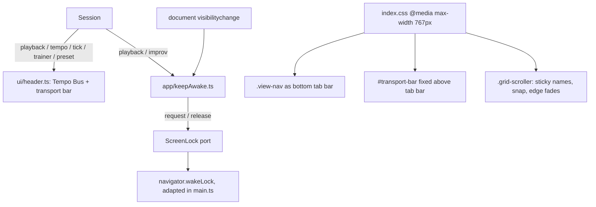

# Mobile App Design

**Spec**: `.specs/features/mobile-app/spec.md`
**Status**: Approved

---

## Architecture Overview

The phone layout is CSS under the existing `@media (max-width: 767px)` block, applied to the markup the desktop already uses. Three things are new markup or code: the Editor transport bar, the install metadata, and a keep-awake rule in the app layer. Layout claims are proven in a real Chrome; behaviour claims in the existing happy-dom integration tests.

### Approaches considered

| Approach | Verdict |
| -------- | ------- |
| **A. Restyle the existing `.view-nav` as the tab bar on phones** (recommended) | One set of buttons, one `aria-current` rule, the Improv dot already on the link. The header loses `backdrop-filter` on phones, because a filtered ancestor would trap a `position: fixed` child. |
| B. A second, phone-only tab bar element | Two sets of buttons to keep in step (L-004), two Improv dots. Rejected. |

| Test approach for layout | Verdict |
| ------------------------ | ------- |
| **Chrome through `playwright-core`, in a separate Vitest config started on the Vite dev server** (recommended) | Measures real boxes: scroll width, hit areas, sticky names, snap. `playwright-core` downloads no browser; it drives the Chrome the machine and `ubuntu-latest` already have. |
| `@vitest/browser` | Needs a Vitest upgrade from 1.x. Rejected for this feature. |
| Screenshots judged by eye only | No test fails when a later change spills the page again. Rejected. |

## Code Reuse Analysis

### Existing Components to Leverage

| Component | Location | How to Use |
| --------- | -------- | ---------- |
| `.view-link` buttons and `renderView` | `index.html`, `src/ui/header.ts:96` | Become the tab bar; `aria-current` already marks the current one |
| `#improv-dot` | `index.html`, `src/ui/improv.ts:21` | Already on the Improv link, so it rides into the tab bar |
| `session.stepBpm` / `canStepBpm` | `src/app/session.ts:243` | The transport `−` / `+` call the same rule as the Stadium buttons |
| `renderTempoSteps` | `src/ui/stadium.ts:175` | The pattern the transport bar copies for disabling `−` / `+` |
| `renderPlayback`, `renderTempo`, `renderTick` | `src/ui/header.ts` | Extended to draw the transport bar beside the Tempo Bus card |
| Integration harness | `tests/app.test.ts` | Loads `index.html` and `src/main.ts` in happy-dom with a mocked engine; transport and tab tests go here |
| `--bg`, `--neon-green`, `--surface-flat` tokens | `src/ui/index.css` | Tab bar, transport bar and manifest colours |

### Integration Points

| System | Integration Method |
| ------ | ------------------ |
| Session events | `keepAwake` subscribes to `playback` and `improv` |
| Vite `base` | Manifest and icons live in `public/` and are linked with relative URLs, so `/MetroRig/` resolves them |
| GitHub Actions | `test` job gains `npm run test:mobile` |

## Components

### Phone layout (CSS)

- **Purpose**: Fit every screen to 360–430 px and give it the tab bar, the compact top bar and the scrolling grid.
- **Location**: `src/ui/index.css`, inside the `max-width: 767px` block, plus base rules for touch feel.
- **Rules**: `header` static, no `backdrop-filter`, top padding `env(safe-area-inset-top)`; `.view-nav` `position: fixed; bottom: 0`, four equal tabs, icon over name, bottom padding `env(safe-area-inset-bottom)`; `main` bottom padding = tab bar height (+ transport bar height in the Editor) so the last element clears them; `.grid-scroller` `scroll-snap-type: x mandatory`, beat-start cells `scroll-snap-align: start`, track names `position: sticky; left: 0`; `.figure-palette` `flex-wrap: nowrap; overflow-x: auto`; fades as `::before` / `::after` overlays toggled by `data-more-left` / `data-more-right` on the scroller; Stadium orb row and tempo row re-flowed to the panel's width; inputs and selects 16 px; 44 px minimum hit areas.

### Grid edge state

- **Purpose**: Tell the CSS which edges have more steps (MOB-25, MOB-26).
- **Location**: `src/ui/editor.ts`
- **Interfaces**: `updateGridEdges(): void` - sets `data-more-left` and `data-more-right` on `.grid-scroller` from `scrollLeft`, `clientWidth`, `scrollWidth` and the names column's width; runs on `scroll`, on `resize` and after `drawGrid`.

### Transport bar

- **Purpose**: Keep `−`, the tempo, `+` and Play/Stop in reach in the Editor (MOB-13 to MOB-22).
- **Location**: markup in `index.html` inside `#editor-view`; wiring in `src/ui/header.ts`, beside the Tempo Bus controls it mirrors.
- **Interfaces**: `#transport-bar` with `#transport-bpm-down`, `#transport-bpm`, `#transport-bpm-up`, `#transport-play`. Play toggles `.playing` like `#btn-play`; `−` / `+` call `session.stepBpm(∓1)` and are disabled from `session.canStepBpm`. Desktop hides it with `display: none` above 767 px.
- **Reuses**: `renderPlayback`, `renderTempo`, `renderTick`, `renderPreset` in `header.ts` gain one line each; `renderTempoSteps` pattern from `stadium.ts`.

### Keep awake

- **Purpose**: Hold a screen wake lock while the metronome plays or a chord pad sounds (MOB-32 to MOB-35).
- **Location**: `src/app/keepAwake.ts` (rule), adapter in `src/main.ts`.
- **Interfaces**:
  - `interface ScreenLock { request(): Promise<{ release(): Promise<void> }> }` in `src/app/ports.ts`
  - `keepAwake(session: Session, lock: ScreenLock | null, page: { visible(): boolean; onVisible(listener: () => void): void }): void`
- **Rule**: wanted = `session.isPlaying || session.pad.soundingChord !== null`. On each `playback` / `improv` change: wanted and none held → request; not wanted and held → release. On visible again and wanted → request. A rejected request or a `null` lock is swallowed.
- **Reuses**: `session.subscribe`.

### Install metadata

- **Purpose**: Make MetroRig installable and full-screen (MOB-28 to MOB-31).
- **Location**: `public/manifest.webmanifest`, `public/icons/icon-192.png`, `icon-512.png`, `icon-maskable-512.png`, `apple-touch-icon.png`, source `public/icons/icon.svg`; `<head>` of `index.html`.
- **Icon generation**: `scripts/build_icons.js` renders `icon.svg` to the four PNGs through the same `playwright-core` Chrome; the PNGs are committed, as the kit samples are.

### Mobile browser tests

- **Purpose**: Prove the layout criteria in Chrome.
- **Location**: `vitest.mobile.config.ts`, `tests/mobile/setup.ts` (starts Vite's `createServer` on a free port, `globalSetup`), `tests/mobile/phone.test.ts`.
- **Interfaces**: `npm run test:mobile`; `vitest.config.ts` excludes `tests/mobile/`.

## Error Handling Strategy

| Error Scenario | Handling | User Impact |
| -------------- | -------- | ----------- |
| No `navigator.wakeLock` (older iOS, Firefox) | `main.ts` passes `null`; `keepAwake` does nothing | Screen may sleep; playback unaffected |
| Wake lock request rejected (low battery, hidden page) | Promise rejection caught | None |
| Browser releases the lock when the page hides | `onVisible` requests again while wanted | None |

## Risks & Concerns

| Concern | Location (file:line) | Impact | Mitigation |
| ------- | -------------------- | ------ | ---------- |
| `header` has `backdrop-filter`, which makes a fixed child position against the header | `src/ui/index.css:85` | Tab bar would scroll away with the header | Phone block sets `backdrop-filter: none` on `header`; a browser test asserts the tab bar's bottom equals the window's bottom after scrolling |
| The Improv rule makes the header static only on Improv | `src/ui/index.css:1790` | Becomes redundant once the header is static on every phone screen | Fold it into the phone `header` rule |
| Fonts load from Google; layout tests measure text | `index.html:11` | A test run without the network measures the fallback font | Tests wait for `document.fonts.ready`; MOB-02 measures whatever font rendered against the select's own width |
| Tempo Bus and transport bar show one value | `src/ui/header.ts` | A path that updates one and not the other (L-004) | Both drawn in the same render functions; tests cover slider, preset, Stadium step, tick |
| `tests/app.test.ts` is 4,000+ lines | `tests/app.test.ts` | Slow to navigate | New `describe('Mobile App')` block at its end, following the per-feature convention |

## Tech Decisions

| Decision | Choice | Rationale |
| -------- | ------ | --------- |
| Tab bar markup | Restyle `.view-nav` | Approach A |
| Layout tests | `playwright-core` + system Chrome, separate Vitest config | Approach above |
| Keep-awake placement | App layer with a port | The rule decides what the user's device does; `tests/layers.test.ts` lets `app` hold rules with ports, and `main.ts` adapts the browser |
| Icon PNGs | Committed, generated once by a script | No build-time image dependency |
| Grid fades | Data attributes set by `editor.ts`, drawn by CSS | Pure CSS cannot know the scroll position across browsers (scroll-driven animations are not in iOS Safari 17) |
