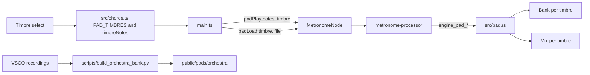

# Pad Timbres Design

**Spec**: `.specs/features/pad-timbres/spec.md`
**Status**: Approved

---

## Architecture Overview

A timbre becomes part of what a slot holds. `play(notes, timbre)` already crossfades whenever the notes change, so a slot that remembers its timbre gives TIM-03, TIM-05 and the fade rules of `chord-pads` with no new fade code. The same chord in another timbre is simply another chord. The Pad keeps one bank per timbre, and one fixed `Mix` per timbre. Which notes a timbre plays, and which files it has, are data in `src/chords.ts`.



**Approaches considered**

| Approach | Verdict |
| -------- | ------- |
| Timbre as part of a slot, with one bank and mix per timbre | Chosen: every rule of `chord-pads` applies unchanged, and rules stay under `cargo test` |
| A single current bank, swapped on selection | Rejected: the outgoing chord would lose its samples mid-crossfade |
| One `Pad` per timbre | Rejected: three times the chorus and reverb memory, and fades across pads need new code |

**Measured before designing**

- Orchestra: 4 s stereo FLAC files average 0.20 MB, so 13 files take about 2.7 MB, and all pads about 10 MB, under the 12 MB of TIM-36.
- The Choir needs 5 files and the Sweep 8 for MIDI 45 to 70. Their SFZ files carry no level or tuning change that the engine would have to copy.
- The Orchestra's tuning is not established: 7 files measured from -2 to ±34 cents, and section vibrato may explain it. The build script settles it.

---

## Code Reuse Analysis

### Existing Components to Leverage

| Component | Location | How to Use |
| --------- | -------- | ---------- |
| `Slot`, `holds`, `start` | `src/pad.rs:120` | Add `timbre`, so another timbre is another chord |
| `Voice.file_gain`, `next_file` | `src/pad.rs` | TIM-31 needs no new fade |
| `Pad::load`, `nearest_file` | `src/pad.rs:352` | Take a timbre, and read its bank |
| `chordMidi` | `src/chords.ts:46` | `timbreNotes` adds the Orchestra's bass to it |
| `PAD_BANK` and the first-visit load | `src/chords.ts:31`, `src/main.ts` | Become `PAD_TIMBRES` and a load per timbre |
| `parseVolume`, `metrorig_pad_volume` | `src/chords.ts`, `src/main.ts` | The pattern for `parseTimbre` and `metrorig_pad_timbre` |
| `scripts/build_house_kit.py` | `scripts/` | The shape of the Orchestra builder |
| `tests/fixtures/pad_bank_check.py` | `tests/fixtures/` | Reads `PAD_TIMBRES`, so it checks every bank |

### Integration Points

| System | Integration Method |
| ------ | ------------------ |
| WASM binary | Tracked, so it is rebuilt with `npm run build:wasm` |
| `chord-pads` tests | Q22 and Q23 change `pad_22`, and those that read `PAD_BANK` as the first load; each is listed in the task and proves the same rule |
| New Age output | A hash of the `chord-pads` output at `feat/chord-pads`, taken before any engine change, holds TIM-10 |

---

## Components

### Timbre rules

- **Purpose**: Define the timbres, their files and the notes each one plays.
- **Location**: `src/chords.ts`
- **Interfaces**:
  - `PAD_TIMBRES: { name: string; files: PadFile[]; bass: boolean }[]`, in select order, whose index is the timbre id
  - `DEFAULT_TIMBRE: number`
  - `timbreNotes(root: number, type: number, timbre: number): number[]`
  - `parseTimbre(stored: string | null): number`
- **Dependencies**: none
- **Reuses**: `chordMidi`, `parseVolume`

The name, not the index, is stored, so reordering the select never changes a saved choice.

### Banks

- **Purpose**: Hold the shipped files.
- **Location**: `public/pads/choir/`, `public/pads/sweep/`, `public/pads/orchestra/`
- **Dependencies**: none
- **Reuses**: the `G#` to `Gs` renaming

Orchestra keys are 23 to 71 in steps of 4. Keys up to 43 mix cello and contrabass into one file. Key 47 is cello, 51 and 55 viola, and 59 to 71 violin.

### Orchestra builder

- **Purpose**: Turn VSCO recordings into tuned, looping files.
- **Location**: `scripts/build_orchestra_bank.py`
- **Interfaces**: `python3 -I scripts/build_orchestra_bank.py <VSCO folder> <output folder>`
- **Dependencies**: `ffmpeg`, Python standard library
- **Reuses**: the dev-tool shape of `scripts/build_house_kit.py`

For each key it decodes its recordings at 44.1 kHz, pitches them to the key, measures the pitch centre and corrects it, takes a 5 s stretch past the attack, and crossfades its last second into its first over 1 s with equal power. That leaves a 4 s loop with no onset, so `loop_start` is 0 and `loop_end` is the last frame. It writes with `-bitexact`, so TIM-25 holds.

### Pad engine

- **Purpose**: Render any timbre.
- **Location**: `src/pad.rs`
- **Interfaces**:
  - `play(&mut self, notes: &[u8], timbre: u8)`
  - `load(&mut self, timbre: u8, key: u8, left, right, loop_start, loop_end)`
- **Dependencies**: none
- **Reuses**: `Slot`, `Voice`, the fades and the 3-slot limit

Rules:
- `MAX_NOTES` is 7 (TIM-15).
- `holds` compares the notes and the timbre.
- `MIXES: [Mix; 5]` holds `synth`, `samples` and `chorus` per timbre, at the top of the file for T14. Analog has no samples, and Orchestra has no synth.
- A voice's synth gain is the mix's synth plus `1 - file_gain` of the Analog synth for a timbre with none, which gives TIM-30 and TIM-32 from the existing file fade.
- Sample output goes to the chorus bus by the mix's `chorus` fraction, and past it by the rest.
- `load` updates only the voices of slots in that timbre (TIM-33).
- With New Age, every value is what `chord-pads` computes, so its output does not move (TIM-10).

### Engine mix and bridge

- **Purpose**: Carry the timbre to the engine.
- **Location**: `src/lib.rs`, `src/audio/metronome-processor.ts`, `src/audio/MetronomeNode.ts`
- **Interfaces**: `engine_pad_play(ptr, n0..n6, count, timbre)`, `engine_pad_load(ptr, timbre, key, ...)`, `padPlay(notes, timbre)`, `padLoad(timbre, key, url, loopStart, loopEnd)`
- **Dependencies**: Pad engine
- **Reuses**: the pad messages

### Improv select

- **Purpose**: Choose the timbre, and load what it needs.
- **Location**: `index.html`, `src/main.ts`, `src/index.css`
- **Interfaces**: `#pad-timbre`, `localStorage` key `metrorig_pad_timbre`
- **Dependencies**: Timbre rules, the bridge
- **Reuses**: the first-visit load, its notices and retry

Load state is kept per timbre. Files stay queued one at a time, and notices always describe the selected timbre.

---

## Data Models

```typescript
interface PadFile { key: number; url: string; loopStart: number; loopEnd: number }
```

```rust
struct Mix { synth: f32, samples: f32, chorus: f32 }
// Added to Slot: timbre: u8. On Pad, samples becomes banks: [Vec<PadSample>; 5]
```

---

## Error Handling Strategy

| Error Scenario | Handling | User Impact |
| -------------- | -------- | ----------- |
| A file of the selected timbre fails | Logged, and its notes use the nearest loaded file | `Some samples unavailable` |
| Every file of the selected timbre fails | The synth plays alone, Orchestra included | `Samples unavailable · synth only` |
| A file of another timbre fails | Logged; the notice waits until that timbre is selected | None on the current sound |
| A stored timbre is unknown | `parseTimbre` returns the default | Choir |

---

## Risks & Concerns

| Concern | Location (file:line) | Impact | Mitigation |
| ------- | -------------------- | ------ | ---------- |
| Section vibrato hides the pitch centre | `scripts/build_orchestra_bank.py` | Files could sit audibly out of tune against each other | The builder uses the long-term spectrum, TIM-17 holds the result, and T14 judges it |
| A 4 s loop of real strings may pulse | `public/pads/orchestra` | A repeating swell | TIM-22 measures it, and TIM-39 rebuilds it |
| Five notes plus bass raise the peak | `src/pad.rs` | PAD-27's level could fail | TIM-20 holds each timbre, and each mix has its own gain |
| Worst case grows to 21 voices | `src/pad.rs` | More CPU | Measured at about 1% before; the test renders it |
| `chord-pads` tests pin New Age as the only bank | `tests/padBank.test.ts`, `src/index.test.ts` | They break on purpose | Q22 and Q23 authorize it; each changed test is reported |
| No Python audio library here | `scripts/build_orchestra_bank.py` | Slow analysis in plain Python | The builder works on decimated audio, and runs only by hand |
| `npm run build` rewrites the tracked WASM with a byte difference | `package.json` | A dirty tree after a gate | Workers use the listed gates, and restore the file when no Rust changed |

---

## Tech Decisions

| Decision | Choice | Rationale |
| -------- | ------ | --------- |
| Timbre identity | Index in `PAD_TIMBRES`, name in storage | Small FFI, and saved choices survive a reorder |
| Bass notes | In `chords.ts`, as more notes of the chord | The engine stays free of music theory |
| Bass files | Cello and contrabass baked into one file per key | One note reads one file, so the engine does not change |
| Orchestra format | Stereo FLAC, 4 s | Sections are stereo, and the sizes fit |
| Sample bus | Chorus per timbre by fraction | The Orchestra demo used less chorus than the others |
