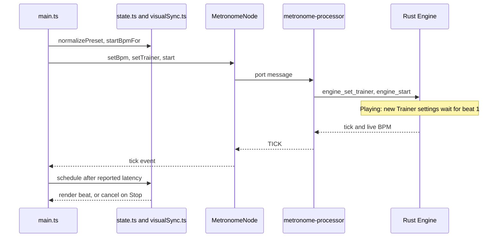
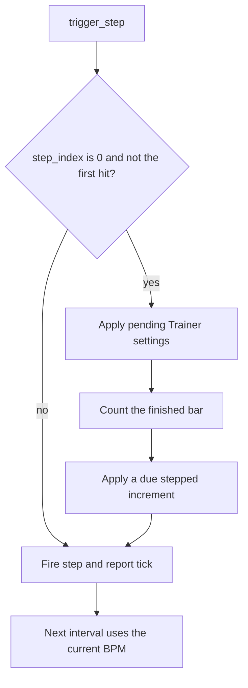

# Precise-Only Metronome Design

**Spec**: `.specs/features/precise-only/spec.md`
**Status**: Approved

---

## Architecture Overview

The Rust engine stays the only clock. Every rule that changes audible time lives there, sample-accurate and covered by `cargo test`. The worklet stays a thin bridge. Pure TypeScript helpers hold the preset and visual rules, and `main.ts` only wires them to the page.



### Engine beat-1 flow



---

## Code Reuse Analysis

### Existing Components to Leverage

| Component | Location | How to Use |
| --------- | -------- | ---------- |
| Sample accumulator | `src/lib.rs:294` | Keep it: the measured hour met the target |
| `engine_load_sample` | `src/lib.rs:415` | Trim leading silence on this one path |
| `getBeatsPerMeasure` and neighbours | `src/state.ts:36` | Put `measureLengthFor`, `normalizePreset` and `startBpmFor` beside these pure helpers |
| Integration test harness | `src/index.test.ts:61` | Drive `main.ts` against the real `index.html` |
| Worklet messages | `src/audio/metronome-processor.ts:100` | Keep the message protocol, minus `SET_SWING` |

### Integration Points

| System | Integration Method |
| ------ | ------------------ |
| Web Audio | Read `baseLatency` and `outputLatency` from the `AudioContext` |
| IndexedDB | Read stored presets unchanged; normalize them when they load into the page |
| Shipped WASM | Rebuild with `npm run build:wasm` |

---

## Components

### Engine

- **Purpose**: Own exact time, Trainer rules, sample playback and restart state.
- **Location**: `src/lib.rs`
- **Interfaces**:
  - `engine_set_trainer(...)` - applies now while stopped; while playing, waits for beat 1, and a disable applies now
  - `engine_start(ptr)` - applies pending settings, clears playing sounds, and starts at Start BPM when the Trainer is on
  - `engine_load_sample(...)` - stores the sample from its first frame at or above 1% of peak
- **Dependencies**: None
- **Reuses**: The accumulator and the current Trainer fields

### Preset rules

- **Purpose**: Hold the rules for meter, stored presets, start tempo and factory content.
- **Location**: `src/state.ts`
- **Interfaces**:
  - `measureLengthFor(numerator: number, denominator: number): number`
  - `normalizePreset(preset: StoredPreset): Preset` - drops `swing` and expands legacy 12/8
  - `startBpmFor(preset: Preset): number`
  - `FACTORY_GROOVES` - moved from `main.ts`, with 24-step Blues Shuffle and Jazz Swing
- **Dependencies**: None
- **Reuses**: The `Preset` type

### Visual sync

- **Purpose**: Delay beat rendering by the reported latency and cancel it on Stop.
- **Location**: `src/visualSync.ts`
- **Interfaces**:
  - `visualDelayMs(baseLatency: unknown, outputLatency: unknown): number`
  - `VisualScheduler.schedule(render: () => void, delayMs: number): void`
  - `VisualScheduler.cancelAll(): void`
- **Dependencies**: Browser timers
- **Reuses**: None

### Audio bridge

- **Purpose**: Pass messages and audio blocks without avoidable work.
- **Location**: `src/audio/metronome-processor.ts`, `src/audio/MetronomeNode.ts`
- **Interfaces**:
  - `MetronomeNode.visualDelayMs(): number`
- **Dependencies**: Engine exports
- **Reuses**: The current message protocol

### Page wiring

- **Purpose**: Separate start-tempo sync from settings sync, and show the live BPM.
- **Location**: `src/main.ts`, `index.html`
- **Interfaces**:
  - `syncAudioSettings()` - sends BPM and all settings, used on Play and preset load
  - `syncPlaybackSettings()` - sends measure length, grid and Trainer without BPM, used by every other change
- **Dependencies**: Preset rules, Visual sync, Audio bridge
- **Reuses**: The current event handlers

---

## Data Models

```typescript
// What IndexedDB may still return for presets saved before this feature
type StoredPreset = Preset & { swing?: number };
```

`Preset` loses `swing`. Stored records are not rewritten on load.

---

## Error Handling Strategy

| Error Scenario | Handling | User Impact |
| -------------- | -------- | ----------- |
| Silent sample | Load it unchanged | The sound stays silent, as it is today |
| Latency unknown or invalid | Count that value as 0 | Visuals run without that delay |
| Invalid Trainer values | Keep the existing guard in `engine_set_trainer` | Previous settings stay active |
| WASM memory grows | Rebuild the cached heap views | None |

---

## Risks & Concerns

| Concern | Location (file:line) | Impact | Mitigation |
| ------- | -------------------- | ------ | ---------- |
| A 1-hour test is slow in a debug build | `Cargo.toml` | Test runs could take minutes | T1 adds an optimized test profile |
| `tsc` already fails on missing AudioWorklet types | `src/audio/metronome-processor.ts:51` | Type errors cannot gate tasks | The Build gate uses the WASM and Vite builds; tests cover behaviour |
| The project has no linter | `package.json` | No lint gate exists | The Build line names none, and no linter is added |
| Trainer tests assert the old timing | `src/lib.rs:582`, `src/lib.rs:626` | They must change with the approved behaviour | T7 rewrites them against TRAIN-02 and TRAIN-03 |
| Swing and reverb tests cover removed features | `src/lib.rs:725`, `src/lib.rs:825` | They cannot stay | T3 and T4 delete them along with the features; `test_measure_total_duration_no_drift` stays without its swing line |
| `src/main.ts` wiring is not unit-testable | `src/main.ts:534` | Page rules could go unproven | Pure helpers carry the rules, and `src/index.test.ts` drives the page |
| Delayed rendering could fire after Stop | `src/main.ts:534` | A beat could flash after Stop | `VisualScheduler.cancelAll()` runs on Stop |

---

## Tech Decisions

| Decision | Choice | Rationale |
| -------- | ------ | --------- |
| Where Trainer rules run | In the Rust engine, with a pending settings slot | Beat 1 is known exactly there. A JavaScript scheduler would depend on message timing and could miss the sample |
| Accumulator versus absolute positions | Keep the accumulator | The measured hour meets the target, so a rewrite adds risk without benefit |
| Silence trim location | `engine_load_sample` in Rust | One load path, covered by `cargo test`, for every sample |
| Seconds Trainer counter | Restart when the increment applies | Changes stay at least the configured seconds apart |
| Pending settings equal to the active ones | Leave the bar and seconds counters running | A groove change during a run must not delay the Trainer |
| Missing single latency value | Count that value as 0 and keep the other | Browsers can report one value without the other |
| Live BPM source | The `currentBpm` of each tick | The engine is the only clock, and the tick already carries it |
| Editor BPM format | One decimal only when the value is not an integer | Stepped runs read as integers, and Smooth runs show their real value |
