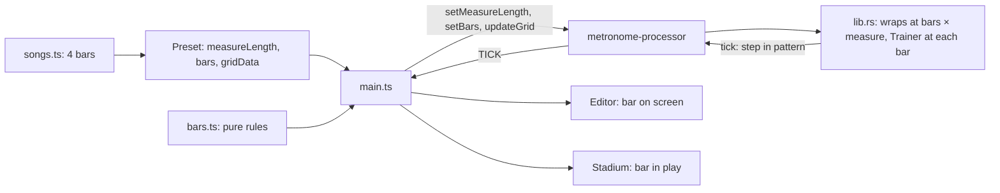

# Song Bars Design

**Spec**: `.specs/features/song-bars/spec.md`
**Status**: Draft

---

## Architecture Overview

A pattern becomes `bars` × `measureLength`. `measureLength` keeps its meaning, the steps of one bar, and a new `bars` says how many bars the pattern holds; a preset with no `bars` holds 1. `gridData` arrays hold the whole pattern.

Approaches weighed:

| Approach | Verdict |
| -------- | ------- |
| Keep `measureLength` as one bar and add `bars` | Chosen. Beats, the clock, figures, `Trainer` and time signature all reason about one bar and stay right; only code that walks a whole pattern changes |
| Let `measureLength` mean the pattern, 64 on a song | Rejected. `getBeatsPerMeasure`, the Smooth Trainer and each `measureLength` reader would need to learn the difference, in about 45 places in `src/main.ts` alone |
| One preset per bar, chained at playback | Rejected. Four presets for one song, and the engine would swap grids at a bar line, the riskiest place to do it |



The engine loops the pattern and keeps counting bars. The bar rules run in `src/bars.ts`, which the tests reach; `src/main.ts` only wires them to the page.

---

## Code Reuse Analysis

### Existing Components to Leverage

| Component | Location | How to Use |
| --------- | -------- | ---------- |
| `barToGrid` | `scripts/tab_to_grid.js` | Called once per bar by the new 4-bar path |
| `normalizePreset`, `completeKit` | `src/state.ts` | The one load path; `bars` is cleaned there |
| `formatBarStep`, `formatSteps` | `src/display.ts` | Keep their signatures; `MAX_STEPS` changes |
| `getBeatForStep`, `isSustainedStep`, `applyFigure` | `src/state.ts` | Take one bar's steps, unchanged |
| `visualScheduler` | `src/visualSync.ts` | Bar changes draw in `renderTick`, so they land with the sound |
| `useSong` confirmation | `src/main.ts` | The model for the time signature confirmation |

### Integration Points

| System | Integration Method |
| ------ | ------------------ |
| Rust engine | New `engine_set_bars`; `engine_update_grid` takes up to 128 steps |
| Worklet | New `SET_BARS` message; `UPDATE_GRID` pads to 128; `gridMirror` follows |
| IndexedDB | `bars` is optional, so no migration |

---

## Components

### Engine

- **Purpose**: Loop `bars` × `measure_length` steps and treat each bar as one measure.
- **Location**: `src/lib.rs`
- **Interfaces**:
  - `engine_set_bars(ptr, bars: u32)` - accepts 1 to 4, and returns to step 0 if the step falls outside the pattern
  - `engine_set_measure_length(ptr, length: u32)` - still refuses more than 32
- **Dependencies**: none
- **Reuses**: `on_measure_complete`, which now runs whenever `step_index % measure_length == 0`. The Smooth Trainer already multiplies by `measure_length`, so it needs no change

### Bar rules

- **Purpose**: Every pure rule about bars in one place.
- **Location**: `src/bars.ts`
- **Interfaces**:
  - `barCount(preset): number`
  - `patternLength(preset): number`
  - `barOfStep(step, measureLength): number`, `stepInBar(step, measureLength): number`
  - `barSteps(steps, bar, measureLength): number[]`
  - `writeBar(steps, bar, measureLength, values): void`
- **Dependencies**: `Preset` type
- **Reuses**: nothing

### Page wiring

- **Purpose**: Show and edit one bar, and follow playback.
- **Location**: `src/main.ts`, `index.html`
- **Interfaces**: `viewBar`, the bar on screen in the Editor, and `playBar`, the bar in play, 0 when stopped. `viewBar` moves with the selector and at each new bar; the Stadium reads only `playBar`
- **Dependencies**: `src/bars.ts`
- **Reuses**: `drawGrid`, `drawBeatClock`, `renderTick`, `updateTimeSignature`, `applyPattern`

---

## Data Models

```typescript
interface Preset {
  // ...as today
  measureLength: number; // steps of one bar, at most 32
  bars?: number;         // 1 when absent, 4 on a song
  gridData: Record<number, number[]>; // measureLength × bars steps per track
}

interface Song {
  // ...as today
  bars: number;
  source: { url: string; revisionId: number; measure: number }; // the first of the 4 measures
}
```

`CustomGroove` stays 1 bar.

---

## Error Handling Strategy

| Error Scenario | Handling | User Impact |
| -------------- | -------- | ----------- |
| Stored `bars` does not fit the stored steps | `normalizePreset` sets 1 bar | The first bar's steps play, nothing breaks |
| Time signature over 32 steps per bar | The existing alert | Old time signature stays |
| Time signature change declined | The inputs return to the old values | Nothing changes |
| A tab bar with a note off the grid | The converter refuses it | That stretch is not used |

---

## Risks & Concerns

| Concern | Location (file:line) | Impact | Mitigation |
| ------- | -------------------- | ------ | ---------- |
| Three hard-coded 32s in the worklet | `src/audio/metronome-processor.ts:114` | Bars 3 and 4 play silence | T2 replaces them with one constant and tests a step past 32 |
| Tuplets cannot sit on the 16-step grid | `scripts/tab_to_grid.js:70` | Fills in triplets are refused, so "fills included" holds only for fills on the grid | T8's stretches avoid those bars; a song keeps its real fills otherwise |
| Rebuilding the grid at each bar | `src/main.ts:263` | About 130 elements every 1.1s at 212 BPM | Redraw only on a bar change; the walk watches for lag |
| A tick for a bar after the pattern changed | `src/main.ts:667` | Stale bar on screen | `loadPresetIntoUI` already cancels pending ticks; `viewBar` and `playBar` reset there |
| `STEPS` copy is pinned by 7 tests and AD-002 | `tests/display.test.ts:35` | Those tests change on purpose | Changed by CNT-01.4; AD-002 records it |
| The wasm in `public/pkg` is tracked | `public/pkg/metrorig_audio_bg.wasm` | A stale binary plays 32 steps | T4 rebuilds it, and `tests/wasm.test.ts` guards exports |
| Tab quality of Every Day I Have the Blues | `src/songs.ts:257` | Only 30% of its windows vary | The ear approval decides, with the tempo |

---

## Tech Decisions

| Decision | Choice | Rationale |
| -------- | ------ | --------- |
| Engine limit | 128 steps: 4 bars of 32 | The largest pattern the spec allows |
| Tick payload | Step in the pattern, 0 to 63 | The page derives bar and step with `src/bars.ts` |
| Song data | One `bars(...)` text per track, 4 strings of 16 | The bars stay readable in `src/songs.ts`, like `steps(...)` today |
| Bar selector | Buttons in `index.html`, shown only on 4 bars | Keyboard and `aria-pressed` work as on Mute and Solo |

AD-011 records `measureLength` as one bar. AD-002's `STEPS` wording changes with it.
