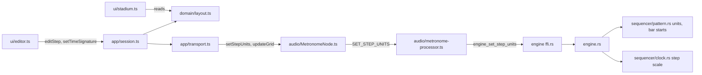

# Tuplets Design

**Spec**: `.specs/features/tuplets/spec.md`
**Status**: Approved - Q20, user: "Recomendacoes" (approach A)

---

## Architecture Overview

A bar is a list of beats, and each beat holds 4, 3 or 6 cells (straight, triplet, sextuplet). `measureLength` keeps its meaning as the straight sixteenths of one bar, the signature's length, and a new optional `beatCells` holds each bar's cell count per beat. `gridData` holds the cells of every bar in order. A preset with no `beatCells` is all straight, so its steps are its cells and nothing stored changes (TUP-28).

Every rule that maps a cell to a bar, a beat or a time lives in one domain module, `src/domain/layout.ts`. The Session, the screens and the transport ask it rather than multiplying `bar × measureLength`.

The engine learns one thing: each cell's length, in twelfths of a sixteenth. A straight cell is 12, a triplet cell 16 and a sextuplet cell 8. The clock waits `samples_per_step × units / 12` samples per cell. For a straight cell the factor is exactly 1.0, so the arithmetic of a pattern with no tuplet stays bit for bit the same (TUP-14), and the golden tests keep their fingerprints. A bar starts where the running sum of units reaches a multiple of `measure_length × 12`.



---

## Code Reuse Analysis

### Existing Components to Leverage

| Component | Location | How to Use |
| --------- | -------- | ---------- |
| `patternLength`, `barSteps`, `writeBar`, `fitBar` | `src/domain/pattern.ts` | Become layout-aware: they take the pattern (`measureLength`, `bars`, `beatCells`) in place of a bare `measureLength` |
| `FIGURES`, `applyFigure` | `src/domain/pattern.ts` | Gain four figures with `cells: 3` or `6`; straight figures carry `cells: 4` |
| `isSustainedStep` | `src/domain/meter.ts` | Takes the bar's beat cells instead of `measureLength` and `beats` |
| `normalizePreset`, `fitBars` | `src/domain/preset.ts` | Validate `beatCells`; drop an invalid layout and fall back to the first bar as today |
| `STRENGTH` rule | `scripts/tab_to_grid.js` | Same order (accent > normal > ghost) for TUP-08 |
| `barsToGrid` | `scripts/tab_to_grid.js` | Reads the measures the new extractor writes, in Songsterr's JSON shape |
| Golden fingerprints | `engine/src/golden_tests.rs` | Prove TUP-14 unchanged |
| `Trainer::on_frame(bpm, samples_per_step, measure_length, …)` | `engine/src/sequencer/trainer.rs` | Unchanged: a tuplet beat lasts a beat, so a bar still lasts `measure_length` sixteenths |

### Integration Points

| System | Integration Method |
| ------ | ------------------ |
| Engine | New `engine_set_step_units(ptr, units_ptr, len)`; `set_measure_length` and `set_bars` reset the units to straight, and the transport sends the units after them |
| Worklet | New `SET_STEP_UNITS` message; `PATTERN_STEPS` 128 → 192 |
| IndexedDB | `beatCells` rides inside the stored preset and groove; no schema version change |

---

## Components

### Layout (`src/domain/layout.ts`)

- **Purpose**: Every rule that places a cell in a bar, a beat and time.
- **Interfaces**:
  - `type Layout = { timeSignature: string; measureLength: number; bars?: number; beatCells?: number[][] }`
  - `barBeatCells(p, bar): number[]` - each beat's cells; straight beats hold `measureLength / beats`
  - `barCells(p, bar)`, `barOffset(p, bar)`, `patternCells(p)`
  - `locateCell(p, cell): { bar, beat, index, cells, inBar }`
  - `cellSpan(p, bar, inBar): [start, end]` - fractions of the bar (TUP-23)
  - `stepUnits(p): Uint8Array` - 12, 16 or 8 per cell (TUP-12, TUP-13)
  - `setBeatCells(p, bar, beat, cells): void` - re-lays one beat on every track (TUP-06, 07, 08)
  - `isTupletSignature(sig): boolean` - true for /4 (TUP-10)
  - `MAX_BAR_CELLS = 48`, `MAX_PATTERN_CELLS = 192`
- **Dependencies**: `meter.ts`, `kit.ts`

### Pattern rules (`src/domain/pattern.ts`)

- `FIGURES` gains `Triplet [1,1,1]`, `Triplet Rest [0,0,0]`, `Sextuplet [1,1,1,1,1,1]` and `Sextuplet Rest`, each with `cells`.
- `applyFigure(p, trackId, bar, cell, figure)` calls `setBeatCells` when the figure's cells differ from the beat's, then writes the figure (TUP-01 to 05, TUP-11). In /8 and /16 a tuplet figure changes nothing (TUP-39).

### Engine pattern (`engine/src/sequencer/pattern.rs`)

- `STEPS_COUNT` 192, `BAR_STEPS_MAX` 48.
- `units: [u8; STEPS_COUNT]`, `bar_start: [bool; STEPS_COUNT]`, `cells: usize`.
- `set_step_units(&[u8]) -> bool` refuses a length past 192, a unit outside {8, 12, 16}, a bar past 48 cells, or a sum that is not `bars × measure_length × 12`.
- `is_bar_start()` reads `bar_start`; `length()` is `cells`.

### Engine clock (`engine/src/sequencer/clock.rs`)

- `set_step_units(units: u8)` sets the length of the cell that just sounded: `samples_per_step × (units / 12)`, recomputed on a tempo change. `Engine::trigger_step` sets it from the pattern before advancing.

### Session (`src/app/session.ts`)

- `editStep` passes figures to `applyFigure`; a tuplet figure in /8 or /16 returns unchanged.
- `setTimeSignature` keeps each surviving beat's cells in /4, straightens in /8 and /16 (TUP-25, 26).
- `onTick` maps the engine's cell index with `locateCell`.
- `saveGroove` stores the bar's `beatCells`; `applyGroove` copies beat by beat, `n mod B` (TUP-29 to 31).

### Screens

- `ui/editor.ts`: 12 sub-columns per beat; a cell spans `12 / cells`; a `3` or `6` label sits in the count row above a tuplet beat; tuplet buttons are disabled outside /4; the footer uses `patternCells` over 192.
- `ui/stadium.ts`: slices from `cellSpan`; the hand moves over each cell for `60 / bpm / 4 × units / 12` seconds; the lit beat comes from `locateCell`.

### Guitar Pro extractor (`scripts/gp_extract.py`)

- **Purpose**: A development tool. Reads `.gp` (zip) or `.gpx` (BCFZ) and writes the drum track's measures as Songsterr-shaped JSON (`voices`, `beats`, `duration`, `tuplet`, `notes[].fret` as MIDI, `ghost`, `accentuated`), plus the time signature and tempo, so `tab_to_grid.js` converts them.
- GP6 drum notes map Element and Variation with alphaTab's table (context Q18).

### Tab converter (`scripts/tab_to_grid.js`)

- A beat whose notes need thirds of a beat becomes a triplet, sixths a sextuplet; the output adds `beatCells` when any beat is a tuplet (TUP-35). A note on no cell of 4, 3 or 6 stops with `A note in measure N falls between cells` (TUP-36).

---

## Data Models

```typescript
interface Preset {
  // ...as today
  measureLength: number;   // Straight sixteenths of one bar: the signature (AD-029)
  beatCells?: number[][];  // Per bar, per beat: 4, 3 or 6 in /4. Absent: every beat straight
}

interface CustomGroove {
  // ...as today
  beatCells?: number[];    // One bar's beats
}

interface Song {
  // ...as today
  beatCells?: number[][];
  source: { url: string; revisionId: number; measure: number }
        | { site: 'Ultimate Guitar'; file: string; measure: number };
}
```

`beatCells` is written only while some beat is a tuplet; a bar returned to straight drops it, so an untouched preset saves as before.

---

## Error Handling Strategy

| Error Scenario | Handling | User Impact |
| -------------- | -------- | ----------- |
| Stored `beatCells` with the wrong shape or values | `normalizePreset` drops it and keeps the first bar | The preset loads straight, as a broken bar count does today |
| Engine gets units that do not sum to the bars | `set_step_units` refuses and keeps the last good layout | Playback continues on the old layout until the next valid message |
| Tuplet figure in /8 or /16 | Session returns before editing | Nothing changes |

---

## Risks & Concerns

| Concern | Location (file:line) | Impact | Mitigation |
| ------- | -------------------- | ------ | ---------- |
| `bar × measureLength` repeated across layers | `src/app/session.ts:212`, `src/ui/editor.ts:149`, `src/ui/stadium.ts:46` | A missed site misplaces tuplet bars | All of them go through `layout.ts`; the test of each screen loads a tuplet bar |
| Engine units and grid sent in separate messages | `src/app/transport.ts:101` | For one block the grid may meet the old units | Units are sent before the grids; `set_step_units` resets `step_index` only when it falls past the end, as `set_bars` does |
| `stadium.ts` hard-codes 4 steps per beat for the hand | `src/ui/stadium.ts:139` | The hand runs at the wrong speed over tuplets | Uses the cell's units |
| GP6 drum table from memory | `scripts/gp_extract.py` | A wrong piece in Times Like These | The user's listening approves both songs (TUP-38) |

---

## Tech Decisions

| Decision | Choice | Rationale |
| -------- | ------ | --------- |
| Cell length unit | Twelfths of a sixteenth (12, 16, 8) | Integers for all three kinds; 12/12 is exactly 1.0 |
| Where the extractor runs | Python 3 stdlib (`zipfile`, `xml.etree`) | Node has no XML parser here and the repo adds no dependency; Python scripts already exist |
| Extractor output | Songsterr's measure JSON | `tab_to_grid.js` and its tests stay the one converter |

> AD-029 in `.specs/STATE.md` records the bar layout, superseding AD-011.
