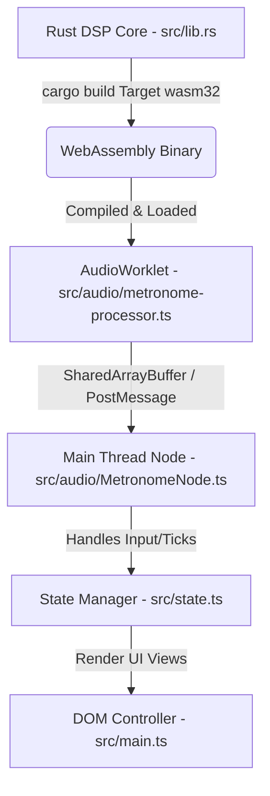

# MetroRig Developer & Contributor Guide

Welcome! This guide explains how to set up the development environment, compile code, run tests, and contribute code modifications to MetroRig.

## Code Architecture Overview

MetroRig separates its audio processing from its UI interactions using modern Web Audio APIs:



1. **DSP Engine (`src/lib.rs`)**: High-performance Rust synthesizer and mixer compiling to raw WebAssembly (WASM).
2. **Audio Worklet (`src/audio/metronome-processor.ts`)**: JavaScript AudioWorklet thread loading the WASM binary and processing actual floating-point audio output.
3. **Main Node Wrapper (`src/audio/MetronomeNode.ts`)**: API interfacing the worklet thread with the main thread.
4. **State Manager (`src/state.ts`)**: Handles local browser state.
5. **UI Layer (`src/main.ts`)**: Binds events and manipulates DOM interfaces.

## Developer Prerequisites

To modify and rebuild the WebAssembly code, you need:
- **Rust Toolchain**: Install via [rustup.rs](https://rustup.rs).
- **WASM compilation target**: Run:
  ```bash
  rustup target add wasm32-unknown-unknown
  ```
- **Node.js** (v18+) and npm.

## Development Workflow

1. **Run Dev Server**:
   ```bash
   npm run dev
   ```
2. **Modify Rust Audio Code**:
   Edit code inside `src/lib.rs`.
3. **Recompile and Sync WASM**:
   To build the updated Rust library and copy the compiled `.wasm` output to Vite's static public folder:
   ```bash
   npm run build:wasm
   ```
   The Vite dev server will pick up the updated WASM file in `public/pkg/metrorig_audio_bg.wasm` and trigger an automatic browser hot-reload.

## Running Tests

MetroRig has independent test suites for the Rust DSP engine and the frontend state controller.

### 1. Rust Unit Tests (DSP Engine)
Runs the DSP math assertions written in Rust:
```bash
npm run test:rust
```
*(or run standard `cargo test`)*

### 2. Frontend JS/TS Unit Tests
Runs Vitest assertions targeting state management:
```bash
npm run test:js
```
*(runs `vitest run`)*

## Contribution Standards

- Preserve type safety inside `MetronomeNode.ts`.
- Maintain pristine compilation: all Rust edits must compile without warnings (`cargo check` or `cargo build` must produce 0 warnings).
- Run all JS and Rust tests before submitting pull requests.
