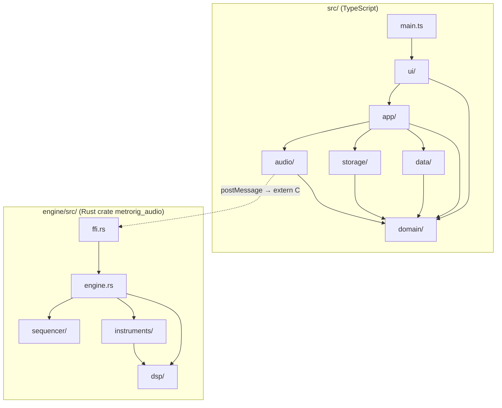

# MetroRig Developer & Contributor Guide

Welcome! This guide explains how to set up the development environment, compile code, run tests, and contribute code modifications to MetroRig.

## Code Architecture Overview

MetroRig has two layer stacks: the Rust engine in `engine/`, compiled to WebAssembly, and the TypeScript app in `src/`. They meet at one seam: the AudioWorklet in `src/audio/metronome-processor.ts` calls the `extern "C"` functions of `engine/src/ffi.rs`. `GLOSSARY.md` defines each layer and the words below.



### The dependency rule

Each layer depends only on the layers below it. Code inside one layer may use any other code of that layer.

| Stack | Layer | Path | May use |
| ----- | ----- | ---- | ------- |
| App | composition root | `src/main.ts` | every layer; the only file that imports `ui` |
| App | ui | `src/ui/` | `app`, `domain` |
| App | app | `src/app/` | `domain`, `data`, `storage`, `audio` |
| App | data | `src/data/` | `domain` |
| App | storage | `src/storage/` | `domain` |
| App | audio | `src/audio/` | `domain` |
| App | domain | `src/domain/` | nothing in `src/` |
| Engine | ffi | `engine/src/ffi.rs` | `engine` |
| Engine | engine | `engine/src/engine.rs` | `sequencer`, `instruments`, `dsp` |
| Engine | instruments | `engine/src/instruments/` | `dsp` |
| Engine | sequencer | `engine/src/sequencer/` | nothing in the crate |
| Engine | dsp | `engine/src/dsp/` | nothing in the crate |

`tests/layers.test.ts` enforces the rule: it fails, naming the file and the import, when code imports against it or closes an import cycle. It also holds the engine to its size limit of 400 production lines per `.rs` file, keeps `extern "C"` and `unsafe` in `engine/src/ffi.rs`, and keeps `src/main.ts` at 150 lines or fewer.

### Where code goes

- **A rule a user sees** (what a click does to the pattern, which preset loads, what a chord plays) goes in `src/domain/` when it needs no I/O, or in the Session (`src/app/session.ts`) when it talks to the engine or the storage. `tests/app/session.test.ts` drives the Session with a fake engine and in-memory storage, without a DOM.
- **A screen** goes in `src/ui/`: `header.ts`, `editor.ts`, `stadium.ts`, `grooves.ts` and `improv.ts` each export `mount(session)`, render Session state and turn gestures into Session commands. Shared DOM helpers live in `src/ui/dom.ts`, display formats in `src/ui/format.ts`.
- **Factory content** goes in `src/data/factory.ts`; **stored data** in `src/storage/`; **the worklet and its node** in `src/audio/`.
- **A sound primitive** goes in `engine/src/dsp/`; **a voice** in `engine/src/instruments/`; **timing, the pattern and the Speed Trainer** in `engine/src/sequencer/`; **mixing** in `engine/src/engine.rs`; **a new export** in `engine/src/ffi.rs`.

## Developer Prerequisites

To modify and rebuild the WebAssembly code, you need:
- **Rust Toolchain**: Install via [rustup.rs](https://rustup.rs).
- **WASM compilation target**: Run:
  ```bash
  rustup target add wasm32-unknown-unknown
  ```
- **Node.js** (v18+) and npm.

## Development Workflow

1. **Run Dev Server**:
   ```bash
   npm run dev
   ```
2. **Modify Rust Audio Code**:
   Edit code inside `engine/src/`.
3. **Recompile and Sync WASM**:
   To build the updated Rust library and copy the compiled `.wasm` output to Vite's static public folder:
   ```bash
   npm run build:wasm
   ```
   The Vite dev server will pick up the updated WASM file in `public/pkg/metrorig_audio_bg.wasm` and trigger an automatic browser hot-reload.

## Running Tests

MetroRig has independent test suites for the Rust engine and the TypeScript app.

### 1. Rust Unit Tests (DSP Engine)
Runs the engine tests, including the golden output test in `engine/src/golden_tests.rs`:
```bash
npm run test:rust
```
*(runs `cargo test --manifest-path engine/Cargo.toml`)*

### 2. Frontend JS/TS Unit Tests
Runs the Vitest suites in `tests/`, including the layer test, the Session test and the page test in `tests/app.test.ts`:
```bash
npm run test:js
```
*(runs `vitest run`)*

## Contribution Standards

- Keep each layer to the dependency rule above; `tests/layers.test.ts` must pass.
- Preserve type safety inside `src/audio/MetronomeNode.ts`.
- Maintain pristine compilation: all Rust edits must compile without warnings (`cargo check` or `cargo build` must produce 0 warnings).
- Run all JS and Rust tests before submitting pull requests.
