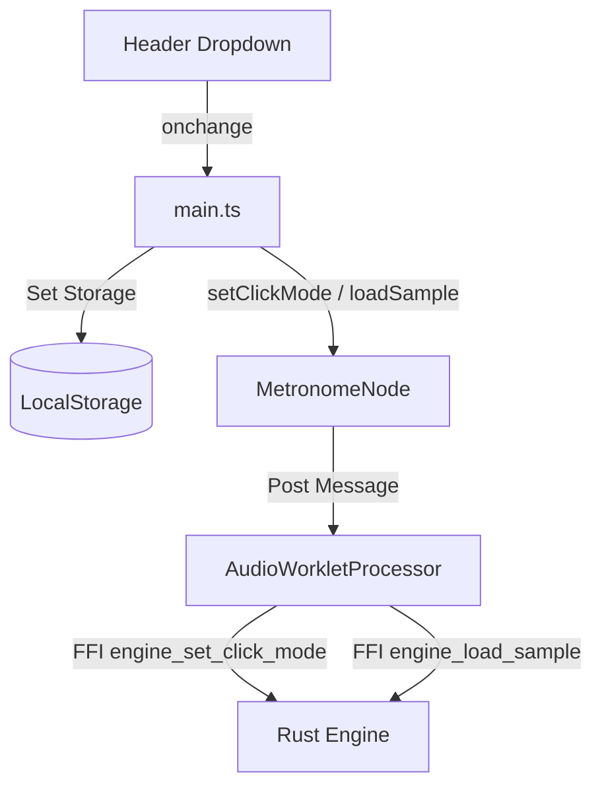

# Design Spec: Click Sound Variations (MetroRig)

This document outlines the design and implementation details for adding a click sound variation selector to MetroRig.

## 1. Overview & Requirements
* **Goal**: Provide user options for the metronome click sound, introducing richer auditory variations.
* **Sound Variations**:
  1. `digital` - Digital Synth Beep (existing sine oscillator)
  2. `mechanical` - Classic Mechanical Metronome Click
  3. `woodblock` - Woodblock / Clave
  4. `stick` - Drumstick Click
  5. `cowbell` - Cowbell
* **Storage / Persistence**: Global user preference stored in `localStorage` (`metrorig_click_sound`) and loaded automatically on start.
* **UI Placement**: In the application header next to the preset dropdown.

## 2. Architecture & Data Flow



* When the user changes the sound in the dropdown:
  1. The selection is saved in `localStorage`.
  2. If `digital`, the JS bridge (`MetronomeNode`) calls `setClickMode(0)` (Synth Mode).
  3. If any other option (e.g. `woodblock`), the JS bridge fetches `/{sound}.wav`, decodes the PCM channels, transfers them to the worklet using `loadSample(0, url)`, and then sets `setClickMode(1)` (Sample Mode).
  4. The Rust Engine routes the click trigger to either the sine oscillator synthesis or sample playback on track 0 (`samples[0]`), adjusting volume for normal vs accented beats.

## 3. Detailed Component Changes

### 3.1 Rust Audio Engine (`src/lib.rs`)
* Add `click_mode: u32` (`0` for digital synth, `1` for sample playback) to `Engine` struct.
* Add `click_accent: bool` to keep track of normal vs accented steps during playback.
* Export `engine_set_click_mode(ptr: *mut Engine, mode: u32)` FFI function.
* Modify `trigger_step` to play `samples[0]` when `click_mode == 1`:
  ```rust
  let click_step = self.tracks[0].steps[self.step_index];
  if click_step > 0 {
      self.click_accent = click_step == 2;
      if self.click_mode == 0 {
          self.active_click_freq = if self.click_accent { 880.0 } else { 440.0 };
          self.active_click_amp = 1.0;
          self.click_phase = 0.0;
      } else if self.samples[0].is_some() {
          self.playback_active[0] = true;
          self.playback_offsets[0] = 0;
      }
  }
  ```
* Modify `fill_buffers` to mix the click sample when `click_mode == 1`.
  * Mix `samples[0]` using a volume factor based on `click_accent` (e.g., `1.0` for accented, `0.5` for normal clicks) to distinguish the beat.

### 3.2 AudioWorklet Processor (`src/audio/metronome-processor.ts`)
* Import and expose FFI function `engine_set_click_mode` in `WasmEngineExports`.
* Process `SET_CLICK_MODE` message to trigger the FFI function.

### 3.3 Metronome Node Bridge (`src/audio/MetronomeNode.ts`)
* Implement `setClickMode(mode: number)` which forwards the message to the worklet.

### 3.4 UI & Controller (`index.html`, `src/main.ts`, `src/index.css`)
* **HTML**: Add `<select id="click-sound-selector">` with appropriate styles inside the header, next to the preset selector.
* **Styles**: Ensure the selector inherits the dropdown styling and fits in header layout.
* **JavaScript**:
  * Read the default setting from `localStorage` on init.
  * Load and set the selected sound when the Audio Context starts.
  * Fetch and load the WAV files on demand or preloaded, and update the mode configuration.

### 3.5 Audio Asset Generation
* Create a script `scripts/generate_clicks.py` to synthesize `mechanical.wav`, `woodblock.wav`, `stick.wav`, and `cowbell.wav` in high-quality mono PCM 16-bit.
* Save generated samples in `public/`.
