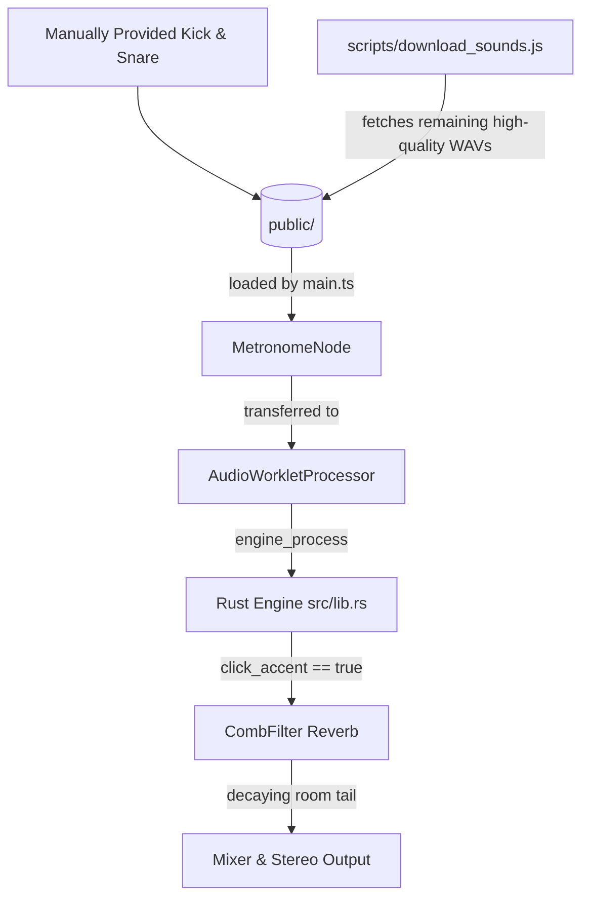

# Design Spec: Snare Sound Replacement & Click Reverb (MetroRig)

This document outlines the design and implementation details for replacing synthesized metronome/drum sound assets with high-quality recorded real acoustic samples and adding a sample-accurate preset room reverb to the accented click beats in the WASM audio engine.

## 1. Overview & Requirements
*   **Goal**: Improve the audio quality of MetroRig's metronome clicks and drum patterns.
*   **Audio Assets Replacement**:
    *   Replace synthesized `.wav` files in `public/` (kick, snare, hi-hat, mechanical, woodblock, stick, cowbell) with high-quality, real recorded samples.
    *   The user manually provides high-quality acoustic `kick.wav` and `snare.wav` from Hellforge Studio's "Classic Heavy Metal Drums" pack.
    *   Create a script `scripts/download_sounds.js` to download the remaining files (`hihat.wav`, `mechanical.wav`, `click.wav`, `stick.wav`, `cowbell.wav`, `woodblock.wav`) automatically from stable open-source repositories to complete the kit.
*   **Click Reverb**:
    *   Add a preset "room space" reverb to the accented click steps (sequencer track 0 steps with value `2`).
    *   The reverb must be implemented directly in the Rust audio engine to run sample-accurately and with zero latency in the AudioWorklet thread.
    *   Only accented click steps should feed the reverb input, but the reverb tail should continue to decay naturally over subsequent beats (without affecting dry normal click steps).

## 2. Architecture & Data Flow



## 3. Detailed Component Changes

### 3.1 Audio Asset Selection & Fetching
The user has manually replaced `kick.wav` and `snare.wav` in the `public/` directory with custom acoustic drum samples. 

We will implement `scripts/download_sounds.js` using Node.js to fetch the remaining high-quality assets:
*   **`hihat.wav`** (Closed Hihat): `https://raw.githubusercontent.com/ArunMichaelDsouza/javascript-drum-kit/master/sounds/hihat-close.wav`
*   **`mechanical.wav`** (Mechanical Metronome Click): `https://raw.githubusercontent.com/rfauver/metronome/master/click.wav`
*   **`click.wav`** (Default Click): `https://raw.githubusercontent.com/rfauver/metronome/master/click.wav`
*   **`stick.wav`** (Stick Click): `https://raw.githubusercontent.com/wesbos/JavaScript30/master/01%20-%20JavaScript%20Drum%20Kit/sounds/tink.wav`
*   **`cowbell.wav`** (808/Drumtraks Cowbell): `https://raw.githubusercontent.com/tidalcycles/Dirt-Samples/master/drumtraks/DT%20Cowbell.wav`
*   **`woodblock.wav`** (Acoustic Woodblock): `https://raw.githubusercontent.com/Manza12/MMM/master/sounds/woodblock.wav`

### 3.2 Rust Reverb Engine (`src/lib.rs`)
A new `Reverb` struct will be added to model a stereo comb-filter with custom delay times:
*   **Left channel delay**: 38ms (`sample_rate * 0.038`)
*   **Right channel delay**: 45ms (`sample_rate * 0.045`)
*   **Feedback/Decay**: `0.45`
*   **Wet Mix**: `0.35`

#### Mixing Logic in `fill_buffers`:
```rust
let (rev_out_l, rev_out_r) = if self.click_accent {
    self.reverb.process(click_out_l, click_out_r)
} else {
    self.reverb.process(0.0, 0.0)
};

let final_click_l = if self.click_accent { rev_out_l } else { click_out_l + rev_out_l };
let final_click_r = if self.click_accent { rev_out_r } else { click_out_r + rev_out_r };
```

## 4. Verification & Testing Plans
*   **Rust Unit Tests**:
    *   Add tests in `src/lib.rs` verifying that the `Reverb` processor correctly decays signal over time.
    *   Test that feeding input into `Reverb` when `click_accent` is false does not alter the output's dry component but still outputs any trailing delay tail.
*   **Build & Execution Verification**:
    *   Verify that `scripts/download_sounds.js` correctly downloads all WAV assets and that the application loads them on initialization.
    *   Run `npm run test:js` and `npm run test:rust` to ensure all tests pass.
